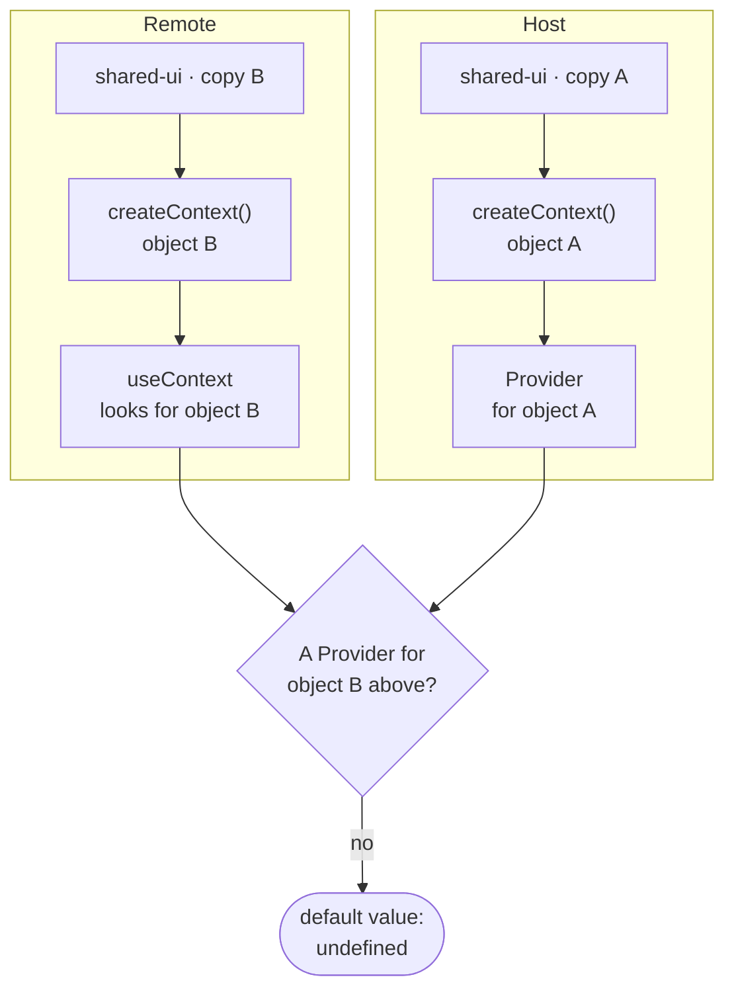
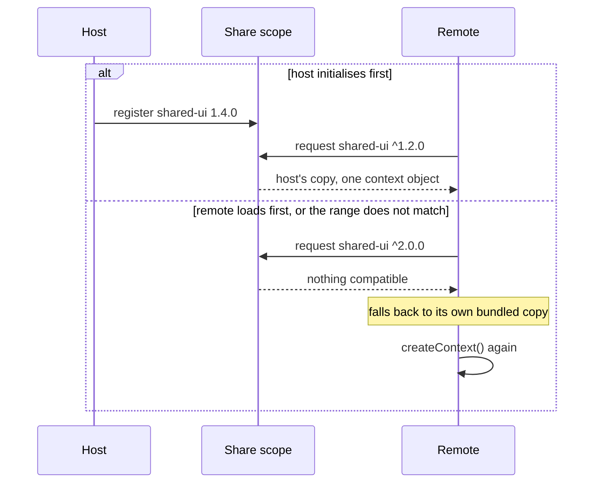

Esto es de principios de 2026 y continúa lo que conté sobre
[Module Federation](/blog/module-federation-kubernetes).

## El síntoma

El usuario elige un proyecto en la navegación. Entra en un módulo federado y el
módulo no sabe qué proyecto eligió: su selector aparece vacío, o peor, con otro
valor.

Lo desconcertante es que todo lo demás funciona. Mismo React, misma página, un
solo árbol de componentes aparentemente. El `Provider` está claramente por
encima del componente que lo lee. Y aun así `useContext` devuelve el valor por
defecto.

## Por qué pasa

El contexto de React no se busca por nombre: se busca por **identidad de
objeto**. `createContext()` devuelve un objeto, y `useContext(MiContexto)` sube
por el árbol buscando un `Provider` cuyo contexto sea *ese objeto exacto*.

```tsx title="shared-ui/src/ProjectContext.tsx"
// Identity, not name: every copy of this file makes a new object.
export const ProjectContext = React.createContext<Project | undefined>(undefined);
```

Con Module Federation, el anfitrión y el remoto pueden acabar cargando copias
distintas del módulo que define el contexto. Dos llamadas a `createContext()`,
dos objetos, y el `useContext` del remoto busca un proveedor que, desde su punto
de vista, no existe.

> [!WARNING]
> No falla. Devuelve el valor por defecto, que casi siempre es `undefined` o un
> objeto vacío. Por eso el síntoma parece un problema de datos y no de carga de
> módulos.



## Lo primero que hay que descartar

Que el paquete esté realmente compartido. En la configuración de federación,
tanto React como la librería que define el contexto tienen que declararse como
`singleton`. Si falta, hay dos copias de verdad y el resto de la investigación
sobra.

```js {3}
shared: {
  react: { singleton: true, requiredVersion: "^18.0.0" },
  "@scope/shared-ui": { singleton: true },
}
```

Pero compartir correctamente **no siempre basta**. Si el remoto se carga antes
de que el anfitrión haya inicializado el ámbito compartido, o si las versiones
no satisfacen el rango declarado, la federación resuelve a la copia propia sin
avisar en producción. El mismo código funciona en desarrollo y falla desplegado,
que es la forma más molesta de fallar.



## La solución provisional, y por qué no basta

Lo primero que hicimos fue sacar el valor del contexto y ponerlo en
`localStorage`, con un evento para notificar cambios. Funciona, desbloquea, y
tiene tres problemas que conviene reconocer en voz alta:

```ts
// The stopgap: global to the origin, text only, no owner.
localStorage.setItem("selectedProject", projectName);
window.dispatchEvent(new Event("selectedProject:changed"));
```

- **Es global al origen.** Dos pestañas comparten el valor, aunque el usuario
  quiera estar mirando dos proyectos distintos.
- **Es texto.** Todo lo que pase por ahí se serializa, y los objetos vivos
  —funciones, instancias— no caben.
- **No tiene dueño.** Cualquier módulo puede escribir cualquier clave. Al cabo
  de unos meses nadie sabe quién pone qué.

Es una tirita honesta. El error sería llamarla arquitectura.

## Hacia dónde va

Lo que de verdad resuelve esto es un almacén explícito para cruzar fronteras:
un objeto pequeño, creado una sola vez por el anfitrión, colgado de un sitio que
todos los módulos puedan alcanzar sin pasar por el sistema de módulos. Con una
API deliberadamente pobre —leer, escribir, suscribirse— y un conjunto cerrado de
claves que están documentadas.

```ts
// A sketch of the shape, not a library.
type SharedKeys = {
  selectedProject: string | undefined;
  namespace: string;
};

interface BoundaryStore {
  get<K extends keyof SharedKeys>(key: K): SharedKeys[K];
  set<K extends keyof SharedKeys>(key: K, value: SharedKeys[K]): void;
  subscribe<K extends keyof SharedKeys>(key: K, fn: () => void): () => void;
}

// Created once by the host, reached without going through the module system.
window.__boundaryStore ??= createBoundaryStore();
```

| | Contexto | `localStorage` + evento | Almacén explícito |
| --- | --- | --- | --- |
| **Sobrevive a dos copias de la librería** | No | Sí | Sí |
| **Alcance** | Un árbol de React | Todo el origen, todas las pestañas | Una página |
| **Objetos vivos** | Sí | No, solo texto | Sí |
| **Quién puede escribir** | El proveedor | Cualquiera, cualquier clave | Cualquiera, claves documentadas |

> [!IMPORTANT]
> La parte importante no es técnica. Es que **lo que cruza la frontera tiene que
> ser una lista corta y escrita**. En cuanto cualquier módulo puede compartir
> cualquier cosa, has reconstruido el estado global que los micro-frontends venían
> a evitar, solo que repartido y sin tipos.

## Lo que me llevo

Que una frontera de módulos no es solo una frontera de despliegue. Es una
frontera de identidad: dos copias del mismo código son dos cosas distintas para
JavaScript, aunque sean idénticas byte a byte.

Y que los fallos que devuelven un valor por defecto en vez de lanzar una
excepción son los que más tiempo cuestan. Un error ruidoso te lleva al sitio; un
`undefined` silencioso te lleva a buscar en el sitio equivocado durante dos días.
