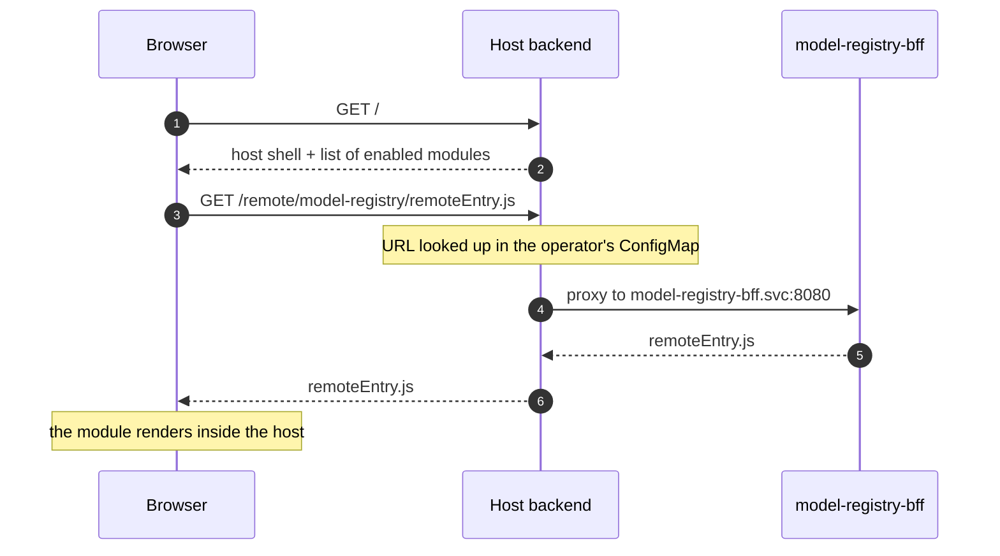
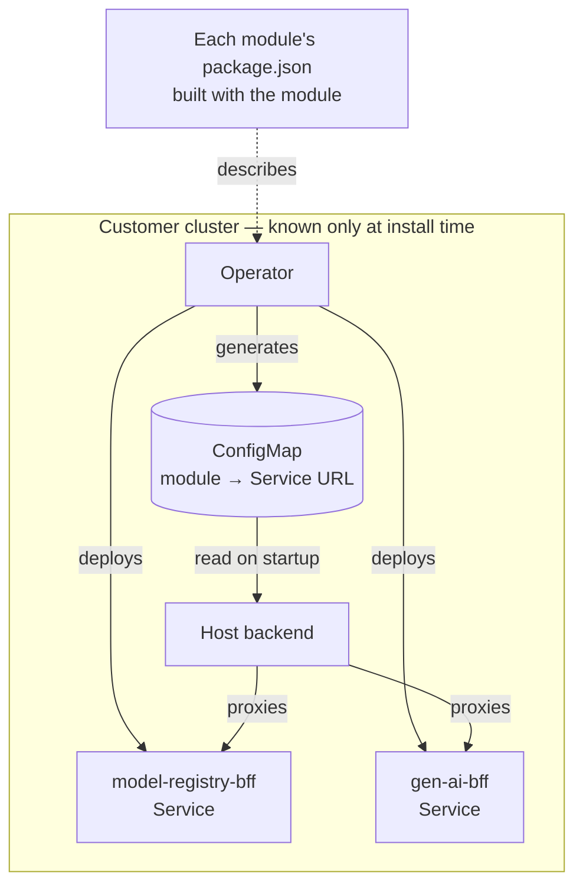

Esto describe el trabajo de 2025 en el dashboard de Open Data Hub, que es
público: [`odh-dashboard`](https://github.com/opendatahub-io/odh-dashboard).

## Qué resuelve y qué no

Module Federation permite que una aplicación cargue, en tiempo de ejecución,
código compilado por otra. La aplicación anfitriona no conoce al módulo remoto
cuando se compila; lo descubre al arrancar, se descarga su `remoteEntry.js` y a
partir de ahí puede renderizar sus componentes como si fueran suyos.

Eso resuelve un problema **organizativo**, no técnico: diez equipos que quieren
publicar su parte de una consola sin coordinarse en una release común. Si lo que
tienes es un equipo y un monolito que va bien, Module Federation te añade
complejidad a cambio de nada. Merece la pena decirlo antes de seguir, porque es
la decisión que más veces he visto tomar por la razón equivocada.

## La parte conocida

El anfitrión declara qué remotos espera y qué dependencias comparte:

```js {5-6}
new ModuleFederationPlugin({
  name: "host",
  remotes: { modelRegistry: "modelRegistry@/remote/model-registry/remoteEntry.js" },
  shared: {
    react: { singleton: true, requiredVersion: "^18.0.0" },
    "react-dom": { singleton: true, requiredVersion: "^18.0.0" },
  },
});
```

`singleton: true` en React no es opcional. Dos copias de React en la misma
página significan dos árboles de hooks y errores que no parecen tener que ver
con nada. Es el primer tropiezo de todo el mundo.

## La parte que nadie cuenta

En ese ejemplo, la URL del remoto está escrita en el código. En un producto que
se despliega en el clúster de otra persona, esa URL **no se puede saber al
compilar**. Depende de qué módulos haya instalado ese cliente, de en qué
espacio de nombres estén y de cómo se llamen sus servicios.

Hay dos piezas que lo resuelven.

**Primero, el descubrimiento.** Cada módulo declara lo que es en su propio
`package.json`, en un campo `module-federation`: su nombre, su punto de entrada,
qué expone. Ponerlo ahí y no en un registro aparte significa que la descripción
del módulo viaja con el módulo y no puede quedarse obsoleta respecto a él.
Más o menos así:

```json
{
  "name": "@odh-dashboard/model-registry",
  "module-federation": {
    "name": "modelRegistry",
    "remoteEntry": "/remoteEntry.js",
    "exposes": { "./extensions": "./extensions.ts" }
  }
}
```

**Segundo, la resolución en tiempo de ejecución.** El operador que instala los
módulos sabe cuáles están activos en ese clúster y qué `Service` tiene cada uno.
Con eso genera un ConfigMap que el anfitrión lee al arrancar:

```yaml
# generated by the operator, never hand-written
modelRegistry: "http://model-registry-bff.redhat-ods-applications.svc:8080"
genAi:         "http://gen-ai-bff.redhat-ods-applications.svc:8080"
```

El anfitrión no resuelve esas URLs en el navegador: las usa para enrutar por
proxy desde su propio backend. Así el navegador solo habla con un origen, y las
direcciones internas del clúster no salen de él.



> [!IMPORTANT]
> Lo que hace que esto funcione es que **quien conoce la topología es quien genera
> la configuración**. El operador es el único componente con esa información, así
> que la configuración se genera donde vive el conocimiento, en lugar de pedirle
> al equipo de cada módulo que la mantenga.



## Lo que cuesta de verdad

**Las dependencias compartidas son un contrato.** En cuanto declaras `shared`,
has acoplado las versiones de todos los módulos. Un equipo que quiere subir de
React 18 a 19 no puede hacerlo solo.

> [!WARNING]
> Module Federation te da independencia de despliegue, no independencia de
> dependencias, y confundirlas duele más adelante.

**Depurar cruza una frontera.** Una traza que empieza en el anfitrión y acaba en
un remoto pasa por código compilado por otro pipeline, con otros source maps.
Vale la pena invertir pronto en que los nombres de los módulos aparezcan en los
errores.

**El fallo hay que diseñarlo.** Si un `remoteEntry.js` no responde, la opción
por defecto es que la consola entera no cargue. Eso es peor que el monolito que
venías a arreglar. Cada remoto necesita su frontera de error: el módulo que falla
desaparece de la navegación y el resto sigue.

```tsx
const ModelRegistry = React.lazy(() => import("modelRegistry/extensions"));

// One boundary per remote: if it fails, only it disappears.
<ErrorBoundary fallback={null} onError={() => hideFromNav("modelRegistry")}>
  <React.Suspense fallback={<Spinner />}>
    <ModelRegistry />
  </React.Suspense>
</ErrorBoundary>
```

## Cuándo sí

Cuando el número de equipos que tienen que publicar sin pisarse es el problema
que te quita el sueño. Si tu problema es otro —rendimiento, tamaño del bundle,
organizar el código— hay respuestas más baratas, y empezar por ellas es casi
siempre la decisión correcta.
