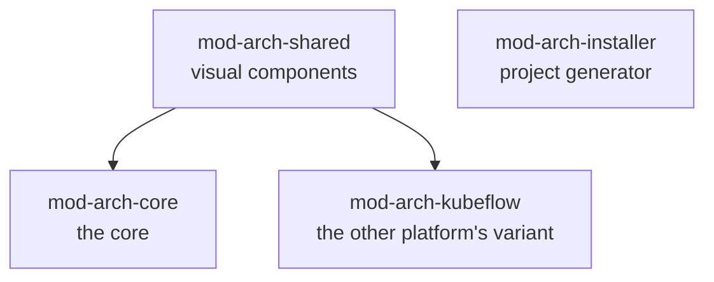
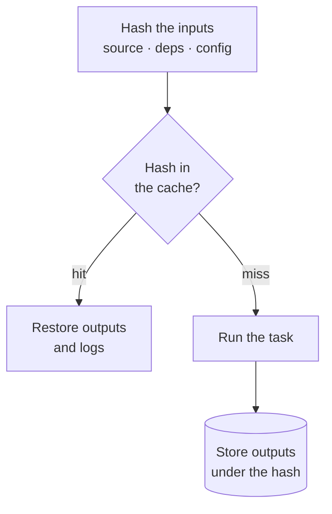
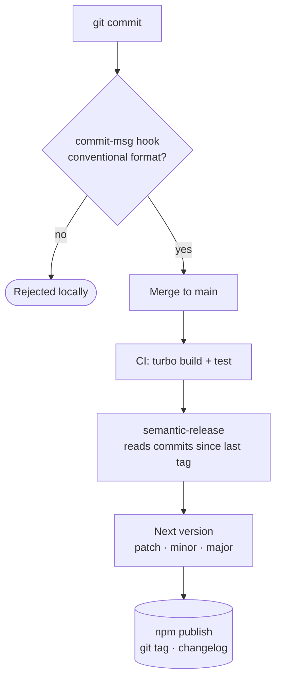
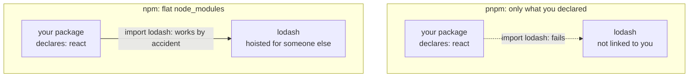

Esto es de 2025 y vive en abierto en
[`mod-arch-library`](https://github.com/opendatahub-io/mod-arch-library).

## Por qué un monorepo y no cuatro repositorios

La librería compartida acabó siendo cuatro paquetes: el núcleo, los componentes
visuales, la variante para otra plataforma y un generador de proyectos. Se usan
entre sí.



Con cuatro repositorios, cambiar algo del núcleo y ver si rompe a los demás
exige publicar una versión de prueba, actualizarla en los otros tres, ejecutar
sus tests y deshacer si falla. Media hora para una pregunta que debería costar
treinta segundos.

En un monorepo, esa pregunta es un comando. Esa es toda la justificación: **el
monorepo existe para que el cambio y su consecuencia se vean juntos.** Lo demás
—compartir configuración, un solo lint— es agradable y no habría bastado.

## Turbo, y para qué sirve de verdad

Turbo orquesta tareas entendiendo el grafo de dependencias entre paquetes.
Declaras que construir un paquete depende de construir aquellos de los que
depende:

```json title="turbo.json" {3}
{
  "tasks": {
    "build": { "dependsOn": ["^build"], "outputs": ["dist/**"] },
    "test":  { "dependsOn": ["build"] },
    "lint":  {}
  }
}
```

Ese `^build` es lo que hace el trabajo: construye primero las dependencias, en
orden, y paraleliza lo que no depende de nada.

```mermaid title="turbo run build: dependencies first, the rest in parallel"
flowchart LR
  subgraph w1["Wave 1 — in parallel"]
    CO["core"]
    KF["kubeflow"]
    IN["installer"]
  end
  subgraph w2["Wave 2"]
    SH["shared"]
  end
  CO --> SH
  KF --> SH
```

Pero el valor principal no es el paralelismo. Es la **caché**: si las entradas de
un paquete no han cambiado, su tarea no se vuelve a ejecutar y se restaura el
resultado anterior. En un cambio que toca un solo paquete, la diferencia entre
reconstruirlo todo y reconstruir uno es la diferencia entre un pipeline que la
gente espera y uno que la gente evita.



> [!WARNING]
> Para que eso funcione hay que declarar bien las `outputs`. Si olvidas un
> directorio generado, la caché lo restaura incompleto y aparecen fallos que solo
> pasan en CI. Es el error típico y vale la pena desconfiar de la caché la primera
> vez que algo no cuadra.

## Publicar sin pensar en versiones

La segunda mitad es semantic-release. La versión no la decide una persona: la
decide el historial de commits.

| Commit | Release | Versión |
| --- | --- | --- |
| **`fix: correct the client on retry`** | Parche | 1.2.3 → 1.2.4 |
| **`feat: add the project selector`** | Menor | 1.2.4 → 1.3.0 |
| **`feat!: change the createClient signature`** | Mayor | 1.3.0 → 2.0.0 |



El efecto no es el que esperaba. Lo que pensaba que ganaba era tiempo; lo que
gané fue **honestidad**. Cuando la versión la pone una persona al final, los
cambios que rompen se cuelan como menores, porque nadie quiere ser quien publica
una mayor un jueves. Cuando la pone el commit, el momento de decidir si algo
rompe es cuando lo estás escribiendo, que es cuando lo sabes.

> [!IMPORTANT]
> El coste es que el formato de los commits deja de ser estilo y pasa a ser
> contrato. Hay que validarlo en el gancho de pre-commit, porque si no, el día que
> alguien escriba «arreglos varios» no se publica nada y nadie entiende por qué.

## La migración a pnpm, y lo que enseñó

A finales de 2025 pasamos de npm a pnpm con Corepack. Las razones habituales —
instalación más rápida, menos disco por los enlaces duros— eran ciertas y no
eran lo importante.

Lo importante es que **pnpm no aplana el árbol de dependencias**. Con npm, un
paquete puede importar algo que no declaró y funciona, porque está ahí arriba
por casualidad. Ese error no se ve hasta que publicas y alguien lo instala sin
esa casualidad. pnpm rompe en local lo que npm rompía en casa del usuario.



La migración encontró tres dependencias no declaradas. Tres bombas de relojería
que ya estaban publicadas.

Y Corepack, que es la parte aburrida: fija la versión exacta del gestor de
paquetes en el `package.json`:

```json title="package.json"
{
  "packageManager": "pnpm@10.0.0"
}
```

Sin eso, el lockfile depende de qué versión de
pnpm tenga instalada cada uno, y vuelves a tener «en mi máquina funciona» en un
sitio nuevo.

## Lo que me llevo

Que estas herramientas no te hacen ir más rápido: te quitan decisiones. Qué
número de versión toca, en qué orden construir, si hace falta reconstruir. Son
decisiones que no aportan nada y que, tomadas a mano cien veces, se toman mal
alguna vez.
