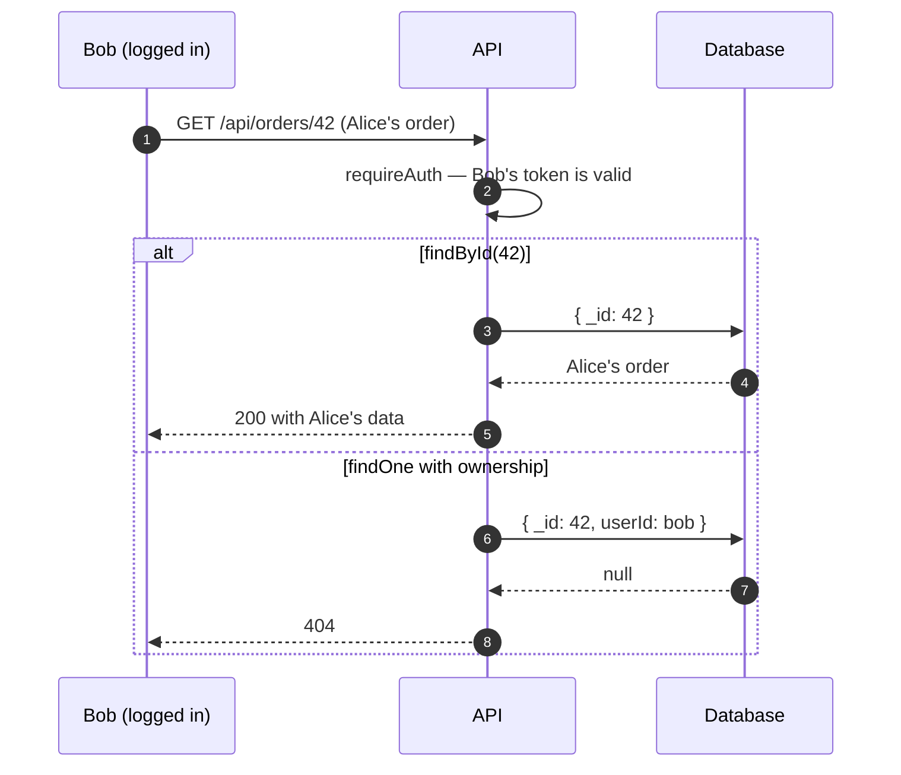
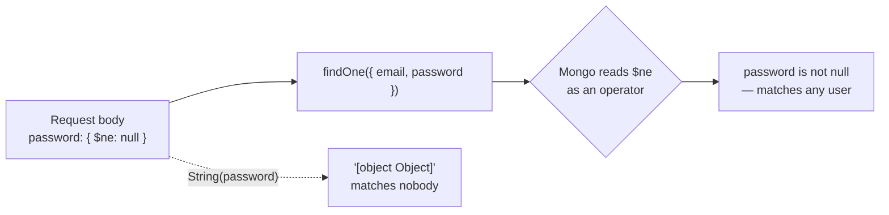
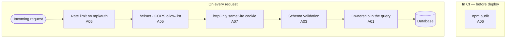

El OWASP Top 10 se lee muchas veces como una lista de conceptos abstractos. En una aplicación normal de Node y React, casi todas las categorías se concretan en unas pocas líneas de código muy reconocibles.

## A01 · Control de acceso roto

Es la categoría número uno por frecuencia, y casi siempre tiene la misma forma: el servidor comprueba **que estás autenticado** pero no **que ese recurso sea tuyo**.



```diff title="src/routes/orders.js"
  app.get("/api/orders/:id", requireAuth, async (req, res) => {
-   // Vulnerable: any authenticated user reads any order
-   const order = await db.orders.findById(req.params.id);
+   // Fixed: ownership is part of the query
+   const order = await db.orders.findOne({
+     _id: req.params.id,
+     userId: req.user.id,
+   });
+   if (!order) return res.sendStatus(404);
    res.json(order);
  });
```

Devolver 404 y no 403 es deliberado: un 403 confirma que el recurso existe.

> [!WARNING]
> **Ocultar un botón en el frontend no es control de acceso.** El cliente es territorio del atacante. Cualquier comprobación que importe tiene que estar en el servidor.

## A03 · Inyección

SQL, NoSQL y comandos del sistema, todos con la misma raíz: concatenar entrada del usuario dentro de algo que luego se interpreta.

```diff
- // Vulnerable
- db.query(`SELECT * FROM users WHERE email = '${email}'`);
+ // Fixed: query and data travel separately
+ db.query("SELECT * FROM users WHERE email = ?", [email]);
```

En MongoDB la inyección tiene una variante que sorprende, porque no hace falta ninguna cadena rara. Si el cuerpo llega como `{"password": {"$ne": null}}`, esto autentica a cualquiera:



```diff
- // Vulnerable
- const user = await User.findOne({ email, password });
+ // Fixed: coerce the type before querying
+ const user = await User.findOne({
+   email: String(email),
+   password: String(password),
+ });
```

La defensa estructural es validar el esquema en el borde, con Zod o Joi, y rechazar lo que no encaje en lugar de intentar limpiarlo:

```js title="src/routes/auth.js" {3-6}
import { z } from "zod";

const Login = z.object({
  email: z.email(),
  password: z.string().min(1).max(200),
});

app.post("/api/auth/login", async (req, res) => {
  const parsed = Login.safeParse(req.body);
  if (!parsed.success) return res.sendStatus(400); // { $ne: null } stops here
  const { email, password } = parsed.data;
  // …
});
```

### XSS en React

React escapa el contenido por defecto, así que el XSS clásico no aplica. Quedan dos huecos:

```jsx
// 1. dangerouslySetInnerHTML — the name is the warning
<div dangerouslySetInnerHTML={{ __html: comment }} />
// If you must render HTML, sanitise first:
<div dangerouslySetInnerHTML={{ __html: DOMPurify.sanitize(comment) }} />

// 2. User-controlled URLs
<a href={userUrl}>Profile</a>
// javascript:alert(1) executes on click
```

Para el segundo caso, valida el protocolo:

```js title="src/utils/safeUrl.js" {4}
function safeUrl(value) {
  try {
    const url = new URL(value);
    return ["http:", "https:"].includes(url.protocol) ? url.href : "#";
  } catch {
    return "#";
  }
}
```

## A02 · Fallos criptográficos

Dos errores que siguen apareciendo: guardar contraseñas con un hash rápido, y comparar secretos con `===`.

```diff
- // Vulnerable: SHA-256 is designed to be fast, which is exactly what you don't want
- const hash = crypto.createHash("sha256").update(password).digest("hex");
+ // Fixed: an algorithm with an adjustable cost
+ const hash = await bcrypt.hash(password, 12);
+ const ok = await bcrypt.compare(password, hash);
```

`bcrypt.compare` además es de tiempo constante. Comparar tokens con `===` filtra información por el tiempo de respuesta; para eso está `crypto.timingSafeEqual`:

```js
import { timingSafeEqual } from "node:crypto";

function sameSecret(a, b) {
  const x = Buffer.from(a);
  const y = Buffer.from(b);
  // timingSafeEqual throws on different lengths, so check that first
  return x.length === y.length && timingSafeEqual(x, y);
}
```

## A05 · Configuración insegura

Lo barato y efectivo, en tres líneas:

```js title="src/app.js" {4-6}
import helmet from "helmet";
import rateLimit from "express-rate-limit";

app.disable("x-powered-by");             // stop advertising the stack
app.use(helmet());                        // security headers
app.use("/api/auth", rateLimit({ windowMs: 15 * 60_000, max: 10 }));
```

El rate limit en los endpoints de autenticación es la diferencia entre una contraseña débil que aguanta y una que cae en una tarde de fuerza bruta.

Y `cors()` sin argumentos permite cualquier origen. Enumera los tuyos:

```diff
- app.use(cors());
+ app.use(cors({ origin: ["https://myapp.com"], credentials: true }));
```

## A07 · Fallos de identificación y autenticación

El debate eterno de dónde guardar el JWT tiene una respuesta razonable: en una cookie, no en `localStorage`.

```js {2,4}
res.cookie("token", jwt, {
  httpOnly: true,   // JavaScript can't read it, so XSS can't steal it
  secure: true,     // HTTPS only
  sameSite: "lax",  // mitigates CSRF
  maxAge: 3600_000,
});
```

`localStorage` es legible por cualquier script de la página, incluido el que entre por una dependencia comprometida. Con `httpOnly` la cookie deja de estar al alcance de JavaScript, a cambio de tener que pensar en CSRF — que es lo que resuelve `sameSite`. El [artículo sobre JWT](/blog/jwt-auth-cookies) recorre los dos ataques.

## A06 · Componentes vulnerables

La categoría más fácil de atender y la más olvidada:

```bash
npm audit
npm audit fix
```

En este mismo sitio, el `npm audit` pasó de 39 vulnerabilidades a cero, y una de ellas venía de un `overrides` que fijaba una versión **vulnerable** de una dependencia transitiva.

> [!CAUTION]
> Mira qué hay en `overrides` antes de dar por bueno el resultado: una cadena de dependencias es tan segura como el pin más antiguo que alguien dejó ahí.

## Lo mínimo viable

Si sólo puedes hacer cinco cosas: valida la entrada con un esquema en el borde, incluye la propiedad del recurso en la consulta, `helmet` y rate limit en auth, cookies `httpOnly` y `sameSite`, y `npm audit` en CI. Cubre la mayor parte del riesgo real de una aplicación web normal, y todo cabe en una tarde.


