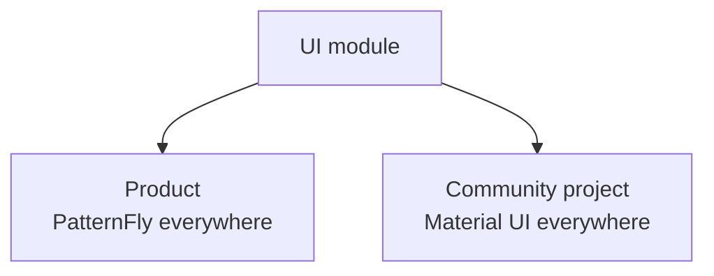
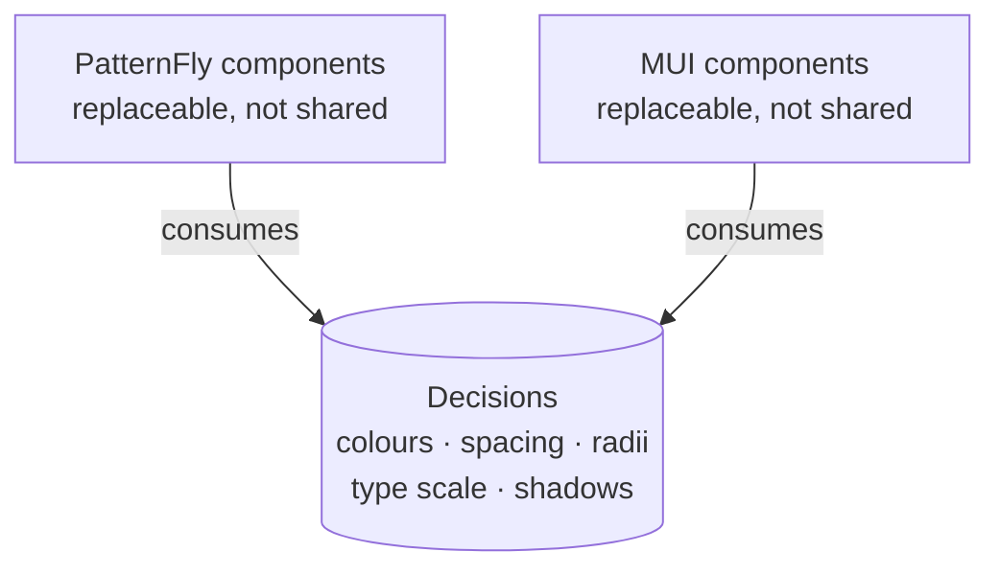
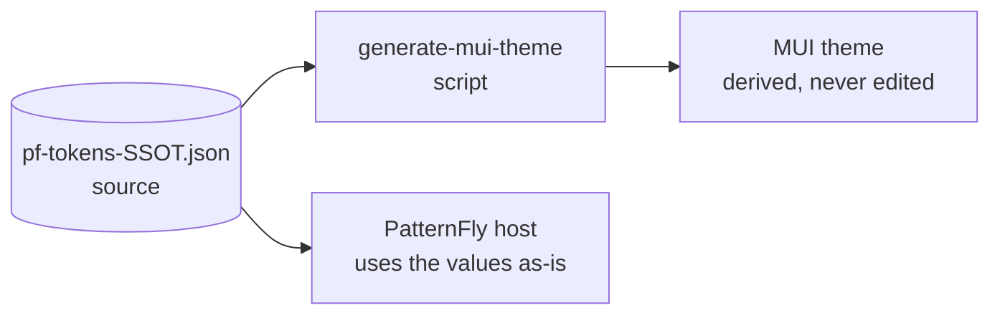
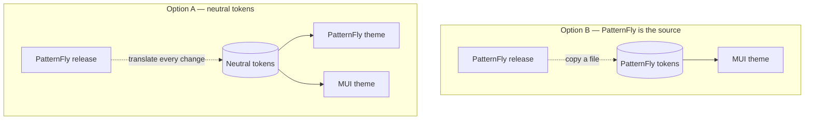
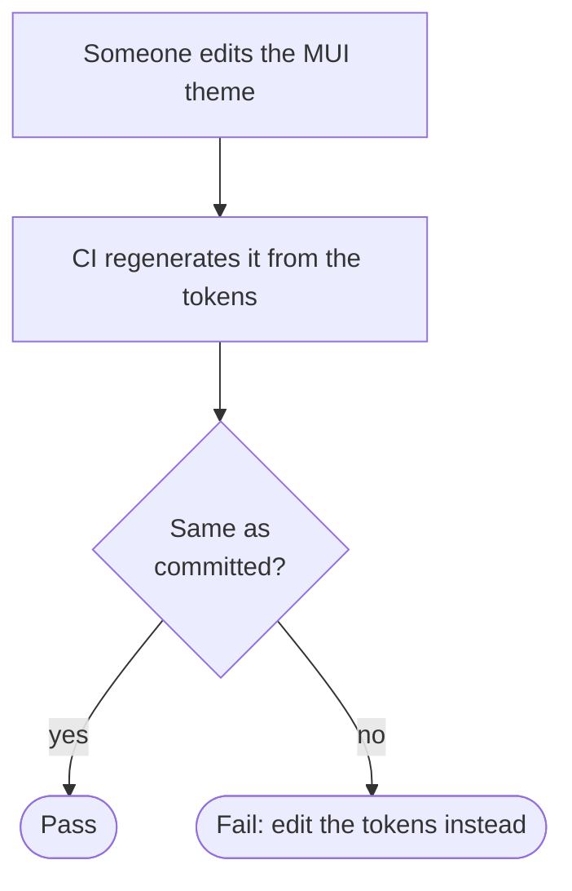

Este trabajo es de finales de 2024 y vive en abierto en
[`mod-arch-library`](https://github.com/opendatahub-io/mod-arch-library).

## El problema

Un módulo de interfaz que se despliega en dos sitios. En uno, el producto usa
PatternFly y todo lo que hay alrededor es PatternFly. En el otro, el proyecto
comunitario usa Material UI y todo lo que hay alrededor es MUI. El módulo es el
mismo en ambos, y en los dos tiene que parecer que siempre estuvo ahí.



Las salidas obvias son todas malas:

- **Mantener dos ramas del módulo.** Se separan en la segunda semana.
- **Envolver todo en componentes propios.** Acabas con un tercer sistema de
  diseño que no se parece a ninguno de los dos y que hay que mantener tú.
- **Elegir uno y que en el otro se note.** Es la opción honesta y la que todo el
  mundo quiere evitar, porque un módulo que desentona parece de peor calidad
  aunque funcione mejor.

## Lo que se hizo

Separar las **decisiones** de diseño de su **implementación**.

Un sistema de diseño tiene dos capas que solemos confundir. Abajo están las
decisiones: cuál es el gris de un texto secundario, cuánto separa un espaciado
medio, qué radio tiene una tarjeta, cómo escala la tipografía. Arriba están los
componentes que las usan. La capa de abajo es la que de verdad define el aspecto
de un producto, y es sorprendentemente pequeña.



Así que esa capa pasa a ser un fichero: un JSON de tokens con los valores de
PatternFly, declarado como el origen único. Y un script genera a partir de él el
objeto de tema que MUI espera.



El origen son las propias variables de PatternFly, capturadas como datos:

```json title="mod-arch-kubeflow/style/pf-tokens-SSOT.json"
{
  "components": {
    "_index": {
      "--pf-v6-c-about-modal-box--BackgroundColor": "var(--pf-t--global--background--color--floating--default)",
      "--pf-v6-c-about-modal-box__brand--PaddingBlockStart": "var(--pf-t--global--spacer--2xl)",
      "--pf-v6-c-about-modal-box__brand--PaddingInlineEnd": "var(--pf-t--global--spacer--xl)"
    }
  }
}
```

El tema de MUI no se edita nunca. Es un artefacto, como un bundle. Si alguien
quiere cambiar un color, lo cambia en los tokens y regenera; si lo cambia en el
tema, el siguiente `generate` se lo borra, que es exactamente lo que debe pasar.

## Por qué esta dirección y no la contraria

Podría haberse hecho al revés: tokens neutros y dos temas derivados. Es más
elegante sobre el papel y peor en la práctica, por un motivo aburrido: uno de
los dos sistemas es el del producto, y el producto manda. Si los tokens son
neutros, cada actualización de PatternFly obliga a traducir sus cambios a tu
vocabulario intermedio. Si los tokens *son* los de PatternFly, actualizar es
copiar un fichero.



> Elegir un origen asimétrico cuando la realidad es asimétrica ahorra una capa de
> traducción permanente. La simetría bonita se paga todos los meses.

## Lo que no se traduce

Esta es la parte que la gente espera que funcione y no funciona, y conviene
decirlo pronto.

**Los tokens se traducen bien.** Colores, espaciados, radios, pesos
tipográficos, sombras: son valores, y un valor es portable.

**Los componentes no.** PatternFly y MUI no tienen el mismo catálogo, y donde
coinciden no coinciden del todo. Un `Select` no se comporta igual, una tabla no
tiene las mismas densidades, los diálogos gestionan el foco de forma distinta.
Intentar mapear componente a componente es volver a la opción del envoltorio
universal por la puerta de atrás.

**Las decisiones de densidad tampoco.** Los dos sistemas asumen cosas distintas
sobre cuánta información cabe en una pantalla, y eso no está en ningún token:
está repartido entre los paddings por defecto de treinta componentes.

| Capa | ¿Viaja entre los dos? | Por qué |
| --- | --- | --- |
| **Tokens** | Sí | Son valores, y un valor es portable |
| **Componentes** | No | Catálogos distintos; donde coinciden, se comportan distinto |
| **Densidad** | No | Vive en los paddings por defecto de treinta componentes, no en un token |

Así que la regla acabó siendo: comparten los valores, no las piezas. El módulo
se escribe una vez con la librería de la plataforma en la que está, y lo que
viaja entre las dos es el vocabulario visual.

## El detalle que lo hace sostenible

Un script que genera un fichero necesita una comprobación que falle cuando el
fichero generado no coincide con su origen. Sin eso, alguien edita el derivado
—con toda la buena intención, para arreglar algo un viernes— y el sistema deja
de tener un origen único sin que nadie se entere hasta meses después.



En CI son dos líneas: regenerar y fallar si el árbol ha cambiado:

```bash title="CI step"
node scripts/generate-mui-theme.mjs
git diff --exit-code   # non-zero if the derived file was hand-edited
```

> [!IMPORTANT]
> Es el mismo patrón que `npm ci` frente a `npm install`, o que un `--check` en un
> formateador: **lo que importa no es poder generar, es poder detectar que lo
> generado está obsoleto.**

## Lo que me llevo

Que «un sistema de diseño» no es una librería de componentes. La librería es la
parte visible y reemplazable; el sistema son las decisiones, y esas caben en un
JSON. Cuando tuvimos que cruzar una frontera entre dos productos, lo único que
pudo cruzarla fue precisamente eso.
