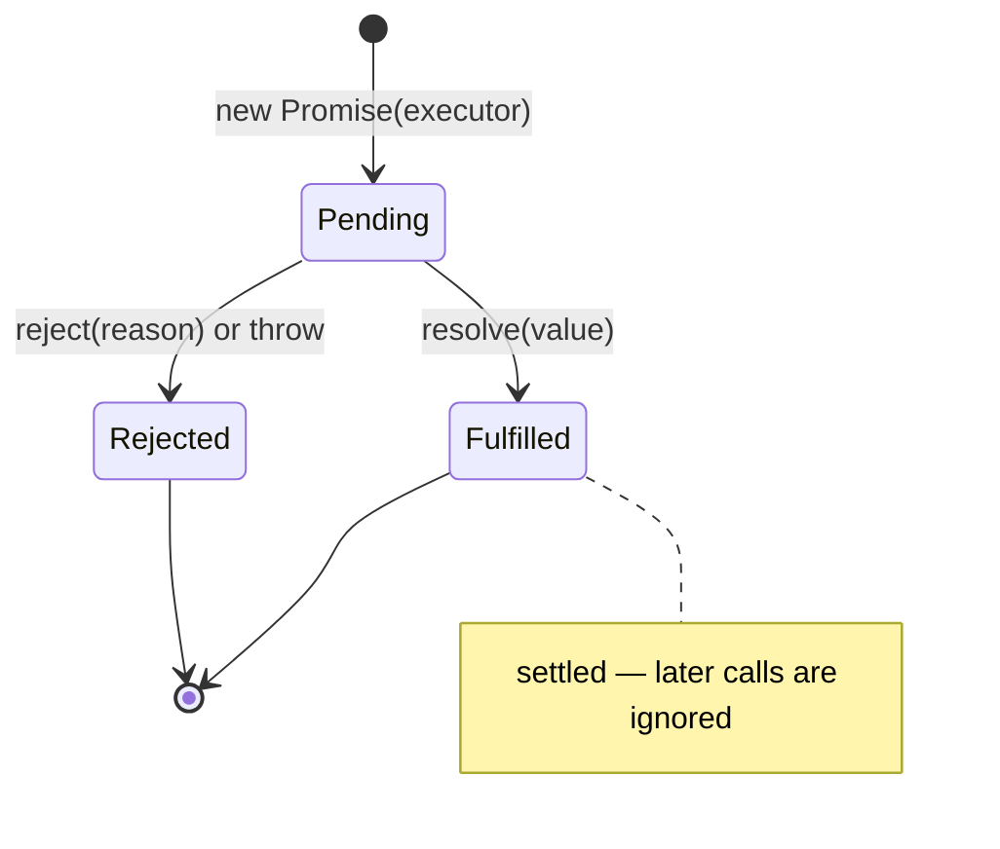
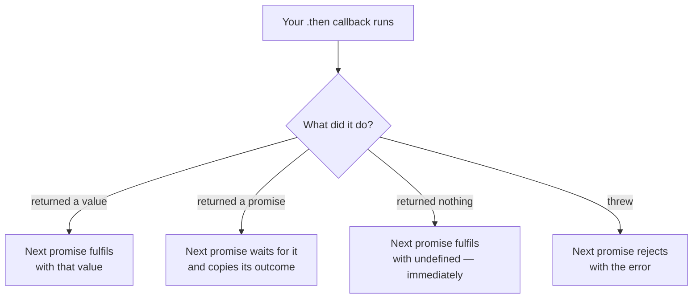
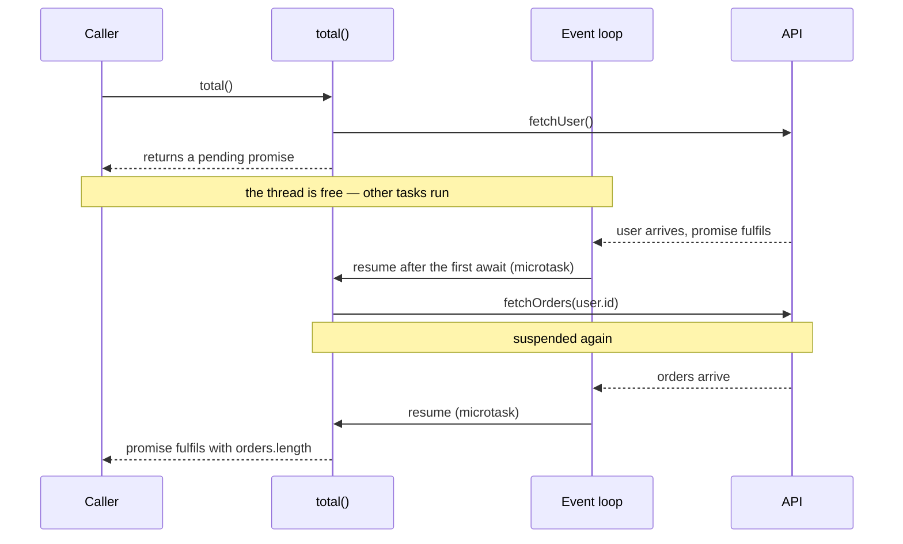
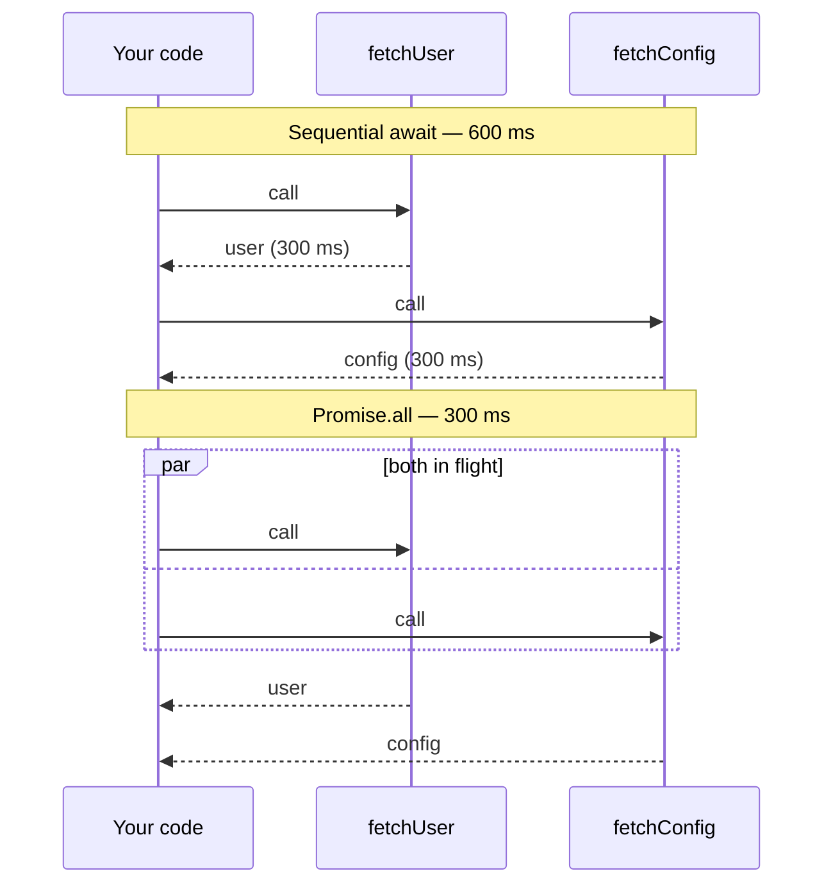

La mayoría de los errores con código asíncrono vienen de una idea equivocada: pensar que una promesa *hace* algo. No hace nada. Una promesa es un objeto con estado que representa un valor que todavía no está.

## Tres estados, una transición

Una promesa está en uno de tres estados: **pendiente**, **cumplida** o **rechazada**. La transición ocurre **una sola vez** y es irreversible.

```js {3}
const p = new Promise((resolve, reject) => {
  setTimeout(() => resolve(42), 1000);
  setTimeout(() => resolve(99), 2000); // ignored entirely
});
```



La segunda llamada a `resolve` no hace nada. La promesa ya resolvió. Esto es una garantía útil: quien consuma la promesa sabe que el callback se ejecutará como mucho una vez.

Y ojo con algo que sorprende: **el ejecutor se ejecuta de forma síncrona**.

```js
console.log("before");
new Promise(() => console.log("inside"));
console.log("after");
// before, inside, after
```

Lo asíncrono no es crear la promesa. Es el `.then`.

## `.then` devuelve una promesa nueva

Esta es la parte que hace que el encadenado funcione, y la que más se malinterpreta.

```js
fetchUser()
  .then((user) => user.id)        // a promise of an id
  .then((id) => fetchOrders(id))  // a promise of orders
  .then((orders) => orders.length);
```

Cada `.then` crea una promesa nueva. Si el callback devuelve un valor, la nueva promesa se cumple con ese valor. Si devuelve una promesa, **se espera a esa promesa** antes de continuar. Si lanza, la nueva promesa se rechaza.



De ahí sale el error más común del encadenado: olvidar el `return`.

```diff
- .then((id) => { fetchOrders(id); })        // wrong: the chain doesn't wait
+ .then((id) => { return fetchOrders(id); }) // right
+ .then((id) => fetchOrders(id))             // also right: implicit return
```

Sin `return`, el callback devuelve `undefined`, la cadena continúa inmediatamente y el siguiente `.then` recibe `undefined` mientras la petición sigue en vuelo.

## `async/await` es la misma máquina

`async/await` no añade capacidades. Es azúcar sintáctico, y saberlo evita esperar magia.

- Una función `async` **siempre** devuelve una promesa, aunque hagas `return 1`.
- `await` no bloquea el hilo. Pausa *esa función*, devuelve el control al event loop, y programa el resto como microtarea.

```js
async function total() {
  const user = await fetchUser();
  const orders = await fetchOrders(user.id);
  return orders.length;
}
// equivalent to the .then chain above
```



La ganancia real es que `try/catch` vuelve a funcionar, y con él las variables intermedias:

```js
try {
  const user = await fetchUser();
  const orders = await fetchOrders(user.id);
  // `user` is still in scope here, which is awkward with .then
} catch (error) {
  // catches a rejection from either
}
```

## El `await` secuencial que no debería serlo

El error de rendimiento más frecuente:

```js
// 600 ms: waits for one, then the other
const user = await fetchUser();     // 300 ms
const config = await fetchConfig(); // 300 ms
```

Si `fetchConfig` no depende de `user`, estás esperando de más. Lánzalas a la vez:

```js
// 300 ms: both in flight
const [user, config] = await Promise.all([fetchUser(), fetchConfig()]);
```



> [!TIP]
> La diferencia es *cuándo llamas a la función*, no dónde pones el `await`. `Promise.all` recibe promesas ya iniciadas.

Atención a la semántica: `Promise.all` **rechaza en cuanto una falla**, descartando el resto. Cuando quieras el resultado de todas pase lo que pase, usa `Promise.allSettled`:

```js
const results = await Promise.allSettled([a(), b(), c()]);
// [{status: "fulfilled", value}, {status: "rejected", reason}, ...]
```

Y para carreras: `Promise.race` resuelve con la primera que termine, sea éxito o fallo; `Promise.any` con la primera que **tenga éxito**.

| Combinador | Se cumple cuando | Se rechaza cuando | Para qué |
| --- | --- | --- | --- |
| **`Promise.all`** | Se cumplen todas | Falla la primera | Peticiones independientes de las que necesitas todos los resultados |
| **`Promise.allSettled`** | Terminan todas, como sea | Nunca | Lotes en los que un fallo parcial es aceptable |
| **`Promise.race`** | La primera en terminar se cumple | La primera en terminar falla | *Timeouts* |
| **`Promise.any`** | Se cumple la primera | Fallan todas | Fuentes redundantes, el *mirror* más rápido |

## Rechazos sin capturar

Una promesa rechazada sin `catch` es un error silencioso en muchos entornos, y una excepción no capturada en Node moderno. Dos sitios donde se escapa:

```js {3,8,12}
// The catch covers nothing: the error happens later
try {
  setTimeout(() => { throw new Error("lost"); }, 0);
} catch { }

// forEach waits for nothing
items.forEach(async (item) => {
  await save(item); // the rejection goes nowhere
});

// Instead
await Promise.all(items.map((item) => save(item)));
```

> [!WARNING]
> `forEach` ignora el valor de retorno del callback, así que las promesas quedan huérfanas: ni se esperan ni se capturan sus errores.

## Lo que hay que llevarse

Una promesa es **un valor futuro**, no una tarea en ejecución. La tarea ya arrancó cuando llamaste a la función; la promesa sólo es el recibo. En cuanto piensas así, dos cosas se vuelven obvias: por qué `Promise.all` va más rápido —las tareas ya estaban en marcha— y por qué olvidar un `return` rompe la cadena —te has quedado con el recibo pero lo has tirado.
