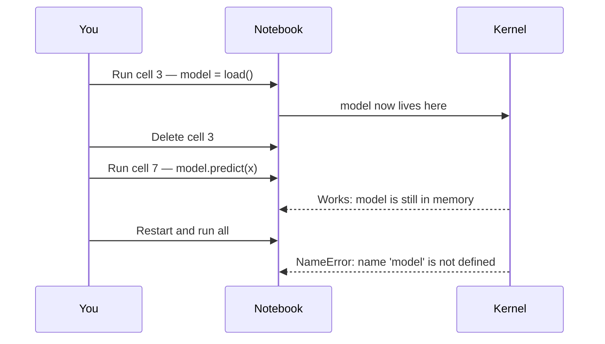
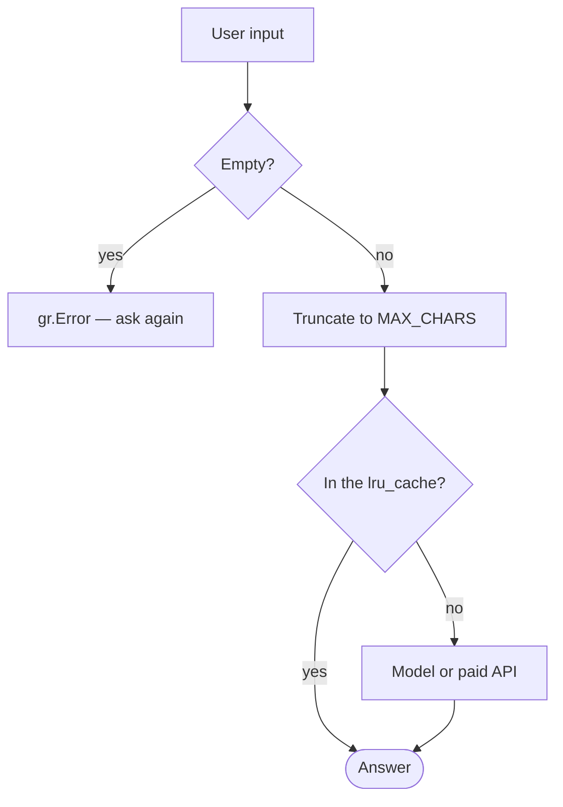

Un notebook es un cuaderno de laboratorio: estado mutable, ejecución desordenada, todo a la vista. Es una herramienta excelente para explorar y pésima para entregar. El salto de una a otra cosa es donde se atascan casi todos los cursos de Python para IA, incluido el mío durante un tiempo.

## Lo que el notebook te deja hacer y luego te cobra

Tres costumbres que en exploración son cómodas y en producción son bugs:

**Ejecución fuera de orden.** Una celda define una variable, la borras, y el código sigue funcionando porque el valor vive en el kernel.



> [!TIP]
> Reinicia y ejecuta de arriba abajo antes de dar nada por bueno: es la única forma de saber si el notebook es reproducible.

**Estado global implícito.** `df` se transforma en catorce celdas distintas. Cuando algo sale mal, no hay forma de saber en qué punto. La disciplina que lo arregla es escribir transformaciones como funciones puras, incluso dentro del notebook:

```python
def clean(df: pd.DataFrame) -> pd.DataFrame:
    return (
        df.dropna(subset=["text"])
          .assign(text=lambda d: d["text"].str.strip().str.lower())
          .drop_duplicates(subset=["text"])
    )

clean_df = clean(raw_df)  # raw_df is untouched
```

Esto no es purismo: es lo que permite probar la transformación y reejecutarla sin miedo.

**Secretos a la vista.** El clásico `API_KEY = "sk-..."` pegado en una celda y después commiteado. En Colab hay un gestor de secretos; úsalo:

```python
from google.colab import userdata
api_key = userdata.get("GOOGLE_API_KEY")
```

Y fuera de Colab, variables de entorno. Nunca literal.

```python
import os
api_key = os.environ["GOOGLE_API_KEY"]  # a KeyError beats a key in the repo
```

> [!WARNING]
> Una clave que ha llegado a un commit está filtrada, aunque borres la celda. Revócala y genera otra.

## Del notebook a una interfaz en veinte líneas

El momento en que el proyecto cambia de naturaleza es cuando otra persona puede usarlo sin leer el código. Gradio hace eso casi gratis:

```python {12}
import gradio as gr

def classify(text: str) -> dict[str, float]:
    scores = model.predict(text)
    return {label: float(score) for label, score in scores.items()}

demo = gr.Interface(
    fn=classify,
    inputs=gr.Textbox(lines=4, label="Text"),
    outputs=gr.Label(num_top_classes=3),
    title="Sentiment classifier",
    examples=["I loved it", "Nothing works properly"],
)

demo.launch()
```

Esos `examples` importan más de lo que parece. Una interfaz vacía obliga al usuario a inventarse una entrada válida; con ejemplos, entiende qué hace la herramienta en dos segundos.

## Lo que se rompe al tener usuarios

En cuanto alguien más lo usa, aparecen problemas que en el notebook no existían.



**Entrada inesperada.** Texto vacío, 50.000 caracteres, otro idioma, emojis. Un notebook explota; una herramienta responde algo razonable.

```python
MAX_CHARS = 5_000

def classify(text: str) -> dict[str, float]:
    text = (text or "").strip()
    if not text:
        raise gr.Error("Please enter some text.")
    if len(text) > MAX_CHARS:
        text = text[:MAX_CHARS]
    ...
```

**El modelo se carga en cada llamada.** El error de rendimiento más común. Cárgalo una vez, a nivel de módulo, no dentro de la función.

```diff
+model = load_model("sentiment")  # once, when the module is imported
+
 def classify(text: str) -> dict[str, float]:
-    model = load_model("sentiment")  # reads the weights on every request
     scores = model.predict(text)
```

**Coste sin límite.** Si detrás hay una API de pago, cada usuario gasta tu dinero. Un límite de longitud y una caché elemental resuelven la mayor parte:

```python
from functools import lru_cache

@lru_cache(maxsize=512)
def embed(text: str) -> tuple[float, ...]:
    return tuple(client.embed(text))
```

`lru_cache` necesita argumentos y retornos hashables, de ahí la tupla en vez de la lista.

## Medir antes de opinar

El último hábito, y el que separa un proyecto de clase de uno real: tener un conjunto de casos de prueba desde el principio. No hace falta nada sofisticado.

```python {7-9}
CASES = [
    ("I loved the service", "positive"),
    ("I've been waiting three days", "negative"),
    ("The order arrived on Tuesday", "neutral"),
]

def predicted_label(text: str) -> str:
    scores = classify(text)
    return max(scores, key=scores.get)

def accuracy() -> float:
    ok = sum(predicted_label(text) == expected for text, expected in CASES)
    return ok / len(CASES)
```

`classify` devuelve una puntuación por etiqueta, así que la comprobación se queda con la más alta. Veinte casos escritos a mano convierten «creo que ahora va mejor» en un número. Sin eso, cada cambio de prompt o de modelo es una opinión, y las opiniones no se pueden comparar entre sí.

## El resumen

| | En el notebook | En la herramienta |
| --- | --- | --- |
| **Estado** | Un `df` global, cambiado en catorce celdas | Funciones puras |
| **Entrada** | Lo que tú escribiste | Validada y acotada |
| **Modelo** | Cargado donde venía bien | Cargado una vez, al importar |
| **Secretos** | Pegados en una celda | `userdata` o el entorno |
| **«¿Va mejor?»** | Una impresión | Un número de los casos de prueba |

El notebook sirve para averiguar **qué** quieres construir. En cuanto lo sabes, el trabajo es otro: funciones puras en vez de estado global, validación de la entrada, el modelo cargado una vez, secretos fuera del código y un puñado de casos de prueba. Nada de eso es avanzado, y es exactamente lo que separa un cuaderno de una herramienta.
