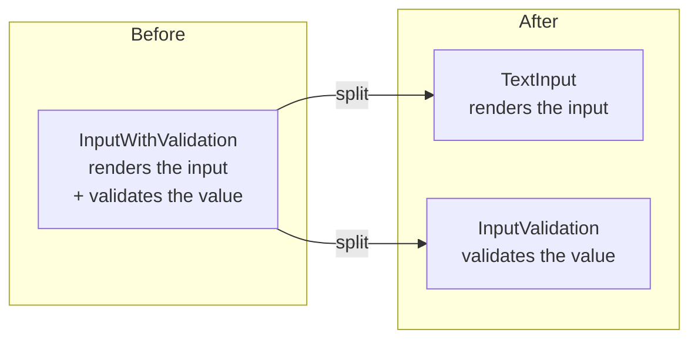
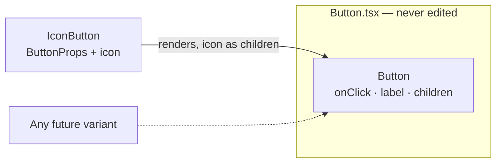
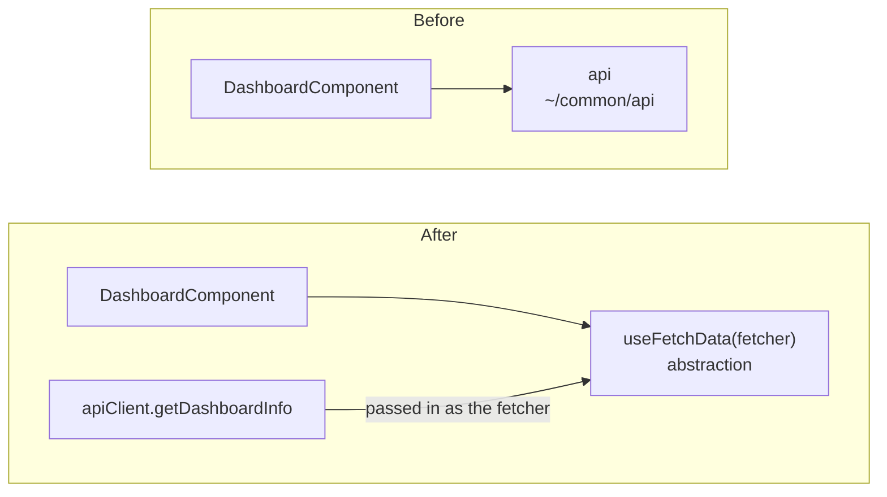

En el mundo del desarrollo de software, siempre buscamos seguir buenas prácticas y principios para crear aplicaciones escalables, mantenibles y robustas. Uno de los conjuntos de principios más conocidos y ampliamente adoptados es SOLID, propuesto por Robert C. Martin. Estos principios ayudan a los desarrolladores a diseñar código de alta calidad y fácil de mantener. En este artículo, exploraremos cómo aplicar los principios SOLID en el contexto de React y proporcionaremos ejemplos de cómo aplicarlos en componentes funcionales tipados.

| Principio | En una frase | En React |
| --- | --- | --- |
| **S** — Responsabilidad única | Una razón para cambiar | Un componente, una tarea |
| **O** — Abierto / cerrado | Extender sin modificar | Composición y `children` |
| **L** — Sustitución de Liskov | Un subtipo cumple el contrato | Un componente derivado acepta y respeta las mismas props |
| **I** — Segregación de interfaz | No depender de lo que no usas | Props mínimas |
| **D** — Inversión de dependencia | Depender de abstracciones | Hooks y clientes inyectados en lugar de imports concretos |

## Principio de Responsabilidad Única (SRP)

Un componente debe tener una única responsabilidad y propósito. Al utilizar componentes funcionales y TypeScript, podemos lograr fácilmente este principio.



```tsx
// Before: one component handles both text input and validation
const InputWithValidation: React.FC = () => {
  /* validation and rendering code */
}

// After: split into two components
const TextInput: React.FC = () => {
  /* only renders the text input */
}

const InputValidation: React.FC = () => {
  /* only validation */
}
```

## Principio de abierto / cerrado (OCP)

Los componentes deben estar abiertos para extenderse pero cerrados para modificarse. Esto significa que no debe ser necesario modificar un componente existente para extenderlo. En su lugar, podemos crear un nuevo componente que extienda el comportamiento del componente existente.

La pieza que lo hace posible es `children`: `Button` acepta contenido extra sin saber qué es, y `IconButton` lo usa para añadir el icono sin tocar una línea de `Button`.

```tsx title="Button.tsx" {4,9,12}
import React from 'react';

export interface ButtonProps {
  children?: React.ReactNode;
  onClick: () => void;
  label: string;
}

const Button: React.FC<ButtonProps> = ({ onClick, label, children }) => {
  return (
    <button onClick={onClick}>
      {children}
      {label}
    </button>
  );
};

export default Button;
```

```tsx title="IconButton.tsx" {11-13}
import React from 'react';
import Button, { ButtonProps } from './Button';

interface IconButtonProps extends ButtonProps {
  icon: string;
}

// Extends Button through composition; Button.tsx is not modified.
const IconButton: React.FC<IconButtonProps> = ({ onClick, label, icon }) => {
  return (
    <Button onClick={onClick} label={label}>
      <span className="icon">{icon}</span>
    </Button>
  );
};

export default IconButton;
```



## Principio de sustitución de Liskov (LSP)

Los componentes deben poder ser reemplazados por sus subtipos sin alterar el comportamiento del programa. Esto significa que los componentes deben ser intercambiables con sus subtipos sin afectar el comportamiento de la aplicación. En el caso de componentes funcionales y TypeScript, podemos lograr esto utilizando la composición en lugar de la herencia.

```tsx {12}
// Base component
interface ButtonProps {
  className?: string;
}

const Button: React.FC<ButtonProps> = (props) => {
  /* base component code */
}

// Derived component: same props, forwarded untouched
const IconButton: React.FC<ButtonProps> = (props) => {
  return <Button {...props} />;
}
```

> [!NOTE]
> En React, «sustituible» significa algo muy concreto: si `IconButton` dice aceptar `ButtonProps`, tiene que respetarlas todas. Un componente derivado que ignora `className` o `onClick` compila igual, pero rompe a quien lo use en lugar de `Button`.

## Principio de segregación de interfaz (ISP)

Una entidad no debe verse obligada a depender de interfaces que no utiliza. En React y TypeScript, esto se traduce en no pasar props innecesarias a los componentes.

```tsx
// Before: passing props the component doesn't need
interface Person {
  name: string;
  age: number;
  address: string;
}

interface PersonComponentProps {
  person: Person;
}

function PersonComponent(props: PersonComponentProps) {
  return (
    <div>
      <div>{props.person.name}</div>
      <div>{props.person.age}</div>
    </div>
  );
}

// After: pass only the props it uses
interface PersonComponentProps {
  name: string;
  age: number;
}

function PersonComponent(props: PersonComponentProps) {
  return (
    <div>
      <div>{props.name}</div>
      <div>{props.age}</div>
    </div>
  );
}
```

## Principio de inversión de dependencia (DIP)

Los componentes de alto nivel no deben depender de los componentes de bajo nivel. Ambos deben depender de abstracciones. En React y TypeScript, esto significa que los componentes de alto nivel no deben depender de los componentes de bajo nivel. En su lugar, ambos deben depender de abstracciones como interfaces o tipos.



```tsx {2,8}
// Before: the high-level component depends on a low-level module
import api from '~/common/api'

const DashboardComponent = () => {
    const [data, setData] = useState([]);

    useEffect(() => {
        api.get('/dashboard').then((response) => {
            setData(response.data);
        });
    }, []);

    return (
        <div>
            {data.map((item) => (
                <div key={item.id}>{item.name}</div>
            ))}
        </div>
    );
}
```

```tsx {3}
// After: both depend on an abstraction
const DashboardComponent = () => {
    const { data, isLoading, error } = useFetchData(apiClient.getDashboardInfo);

    if (isLoading) {
        return <div>Loading...</div>;
    }

    if (error) {
        return <div>Error: {error.message}</div>;
    }

    return (
        <div>
            {data.map((item) => (
                <div key={item.id}>{item.name}</div>
            ))}
        </div>
    );
}
```

> [!TIP]
> `useFetchData` sólo conoce la firma «una función que devuelve una promesa de datos». En un test le pasas un *fetcher* falso y el componente no se entera de que no hay red.
