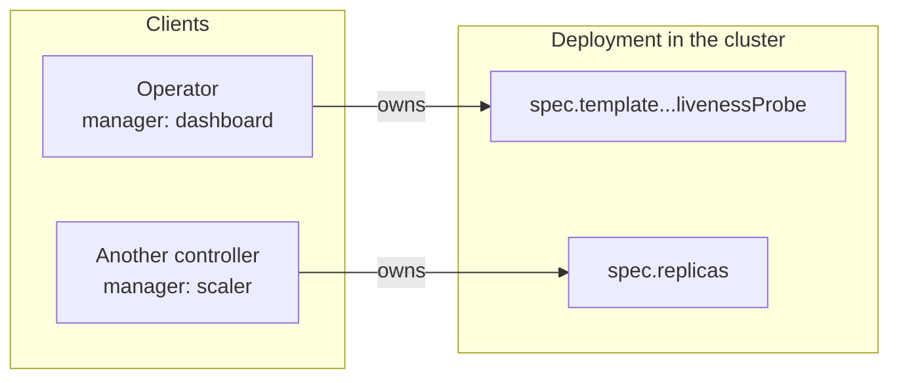
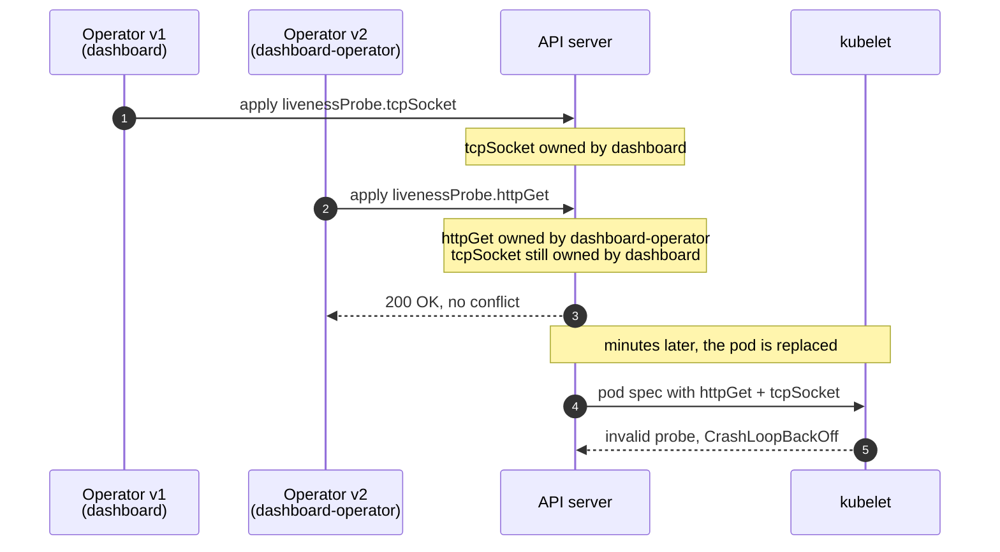

Esto pasó a principios de 2026. Lo cuento sin ticket ni nombres porque el
mecanismo es genérico de Kubernetes y le puede ocurrir a cualquiera.

## El síntoma

Un operador desplegaba su componente y el pod entraba en `CrashLoopBackOff`. No
siempre: al desplegar de cero funcionaba. Solo fallaba al actualizar sobre una
instalación existente, y además con retraso, unos minutos después de la
actualización.

El error del kubelet decía que la sonda de vida era inválida: tenía definidos a
la vez `httpGet` y `tcpSocket`. Y eso es imposible, porque en el manifiesto solo
hay uno.

## Qué es un gestor de campos

Server-Side Apply cambia quién decide el contenido de un objeto. En lugar de
mandar el objeto entero y machacar, cada cliente declara **solo los campos que
le importan** y se identifica con un nombre, el *field manager*. La API guarda,
dentro del propio objeto, qué gestor es dueño de qué campo:

```yaml {3,13}
metadata:
  managedFields:
    - manager: dashboard
      operation: Apply
      fieldsV1:
        f:spec:
          f:template:
            f:spec:
              f:containers:
                k:{"name":"main"}:
                  f:livenessProbe:
                    f:tcpSocket: {}
```

Esa contabilidad es lo que permite que dos controladores toquen el mismo objeto
sin pisarse: cada uno solo puede cambiar lo suyo, y si suelta un campo, la API
lo retira.



La regla de propiedad es lo que importa para el resto de la historia:

| El apply de un gestor… | Qué hace la API |
| --- | --- |
| **Fija un campo que no es de nadie** | Lo fija y apunta al gestor como dueño |
| **Fija un campo que ya es suyo** | Lo actualiza |
| **Fija un campo de otro gestor, con otro valor** | Lo rechaza como conflicto, salvo que el apply sea forzado |
| **Deja de declarar un campo que era suyo** | Retira el campo |
| **Nunca menciona un campo de otro gestor** | No lo toca |

## Lo que hice

Renombré el gestor. El operador pasó de identificarse como `dashboard` a
`dashboard-operator`, porque el nombre viejo venía de cuando el componente era
otra cosa y resultaba confuso.

Cambio de una línea. Ningún efecto visible en el manifiesto.

## Lo que pasó de verdad

Para la API, un gestor con otro nombre es **otro gestor**.

El objeto que ya estaba en el clúster tenía su sonda registrada a nombre de
`dashboard`, con `tcpSocket`. Llegó mi apply como `dashboard-operator`
declarando `httpGet`. La API hizo exactamente lo que se le pide que haga: no
tenía ninguna razón para quitar el campo de otro dueño, así que conservó
`tcpSocket` y añadió `httpGet`.



Así quedó el objeto tras la actualización, recortado:

```yaml {3,8,19-20}
metadata:
  managedFields:
    - manager: dashboard            # the old name, still holding its field
      operation: Apply
      fieldsV1:
        # … f:livenessProbe:
        #     f:tcpSocket: {}
    - manager: dashboard-operator   # the new name, a stranger to the API
      operation: Apply
      fieldsV1:
        # … f:livenessProbe:
        #     f:httpGet: {}
spec:
  template:
    spec:
      containers:
        - name: main
          livenessProbe:
            httpGet: { path: /healthz, port: 8080 }
            tcpSocket: { port: 8080 }   # nobody asked for both
```

El resultado es un objeto que **ningún cliente pidió** y que ninguna validación
rechaza, porque cada campo por separado es legal. Solo el kubelet, al intentar
ejecutar la sonda, descubre que la combinación no tiene sentido.

Y el retraso se explica solo: el pod viejo seguía corriendo. El fallo aparecía
cuando algo provocaba una sustitución y el nuevo intentaba arrancar con la sonda
imposible.

## La lección

> [!IMPORTANT]
> **El nombre del gestor de campos es parte de tu API, aunque no lo parezca.**
> Está escrito dentro de cada objeto que tu controlador ha tocado. Cambiarlo no
> es renombrar una variable: es decirle a la API que llega un cliente nuevo, y la
> contabilidad del anterior se queda ahí.

Las tres formas de salir, de menos a más agresiva:

1. **No renombrar.** Aburrido y correcto. El nombre feo cuesta menos que la
   migración.
2. **Renombrar y limpiar.** Antes del primer apply con el nombre nuevo, retirar
   las entradas del gestor antiguo de los objetos afectados.
3. **Apropiarse.** Aplicar con `force: true` desde el nombre nuevo, que
   transfiere la propiedad de los campos en conflicto. Es lo que acabamos
   haciendo, y funciona siempre que entiendas que estás pisando deliberadamente
   lo que decidió otro.

## Por qué me gusta este fallo

Porque no hay nada roto. La API hizo lo correcto, el manifiesto era válido, el
operador también. El error estaba en una suposición mía: creía que el nombre del
gestor era una etiqueta y era una identidad.

Los fallos más caros que he visto tienen esta forma. No son componentes que
funcionan mal, son componentes que funcionan bien bajo un modelo mental que no
coincide con el real. Y esos no los encuentra un test, porque el test también lo
escribe quien tiene el modelo equivocado.
