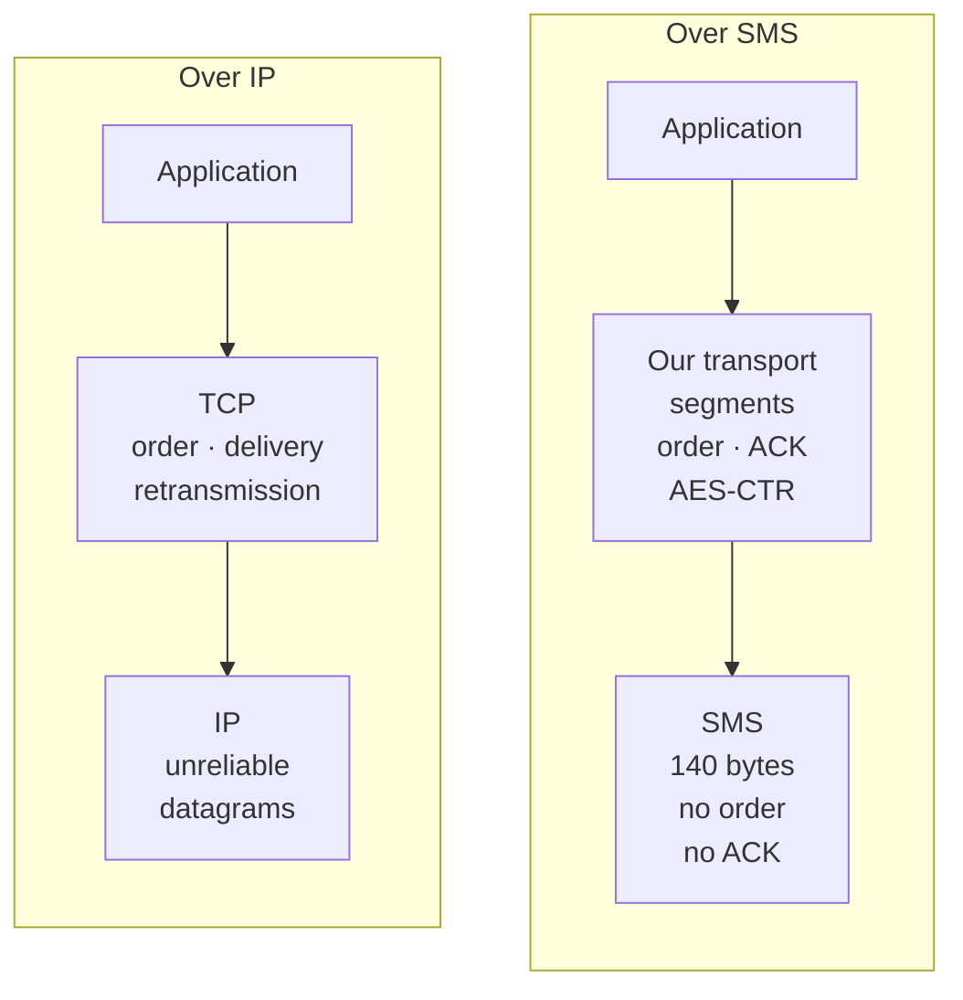
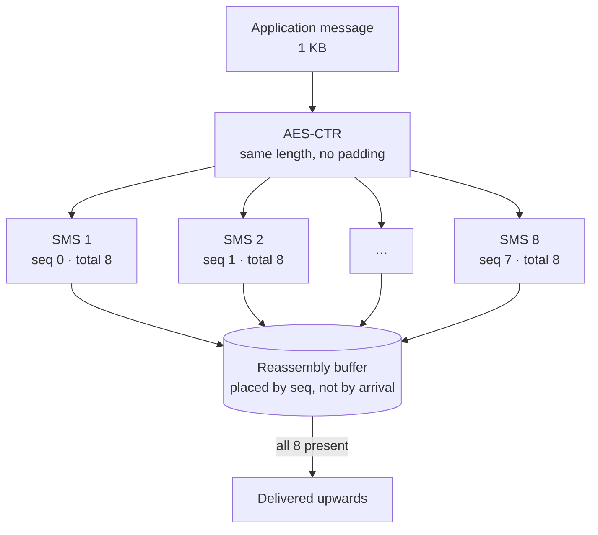
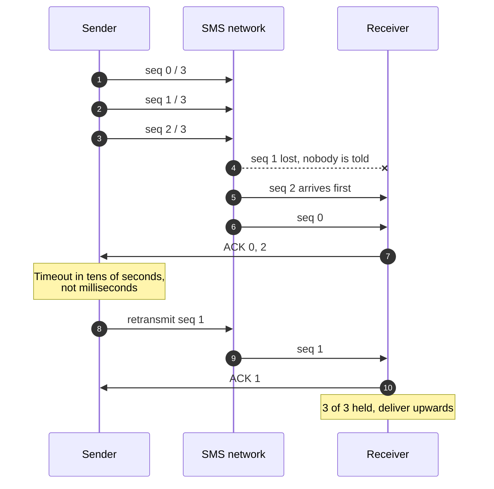
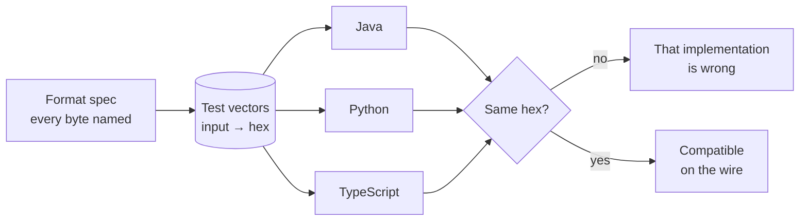

Esto es de 2018, en el equipo de innovación de Telefónica. El código sigue
público y archivado en [`Telefonica/SDK-SMS-Stack`](https://github.com/Telefonica/SDK-SMS-Stack),
y hay un whitepaper que lo acompaña. Lo cuento ahora porque es el proyecto del
que más he aprendido y el que peor he sabido explicar en su momento.

## El problema

Hay sitios sin datos. No hablo de 2G lento: hablo de no tener IP. Un valle, un
sótano, un país donde la tarjeta prepago se quedó sin saldo de datos pero
conserva mensajes. En todos esos sitios casi siempre queda una cosa: el SMS.

La pregunta que nos hicimos fue si se podía tratar el SMS como lo que es —un
canal— y poner encima el resto de la pila. Si el transporte fuese fiable y
ordenado, una aplicación podría hablar por SMS sin saber que lo está haciendo.



## Por qué el SMS es un canal hostil

Un SMS son 140 bytes. Con el alfabeto GSM de 7 bits caben 160 caracteres; en
cuanto metes una eñe o un emoji pasas a UCS-2 y bajas a 70. Esa es la primera
restricción y la más tonta: el tamaño del paquete depende de lo que escribas.

| Codificación | Bits por carácter | Caracteres en 140 bytes | Se activa con |
| --- | --- | --- | --- |
| **GSM-7** | 7 | 160 | Texto latino sin adornos |
| **UCS-2** | 16 | 70 | Una sola eñe, un emoji o un carácter no latino |

Las otras tres son peores:

- **No hay orden.** Dos mensajes enviados seguidos pueden llegar al revés. La
  red no promete nada sobre la secuencia.
- **No hay entrega garantizada.** Un SMS puede perderse sin que nadie te avise.
  El acuse de recibo del operador dice que la red lo aceptó, no que llegara.
- **No hay integridad ni privacidad.** El mensaje viaja en claro y pasa por
  equipos que no controlas.

Es, casi literalmente, un datagrama. Y sobre datagramas poco fiables ya sabemos
construir: eso es exactamente el problema que TCP resolvió en 1974.

## Lo que construimos

Una capa de transporte con las piezas mínimas para que lo de arriba pueda
confiar en ella.

**Segmentación.** Un mensaje de aplicación se parte en trozos que caben en un
SMS, dejando sitio para la cabecera. La cabecera va en los primeros bytes de
cada mensaje y lleva un identificador de conversación, el número de secuencia y
el total de segmentos.

**Secuenciación y reensamblado.** El receptor coloca cada segmento en su sitio
por número de secuencia, no por orden de llegada. Hasta que no tiene todos, no
entrega nada hacia arriba.

**Confirmación y reenvío.** El emisor mantiene los segmentos no confirmados y
los reintenta. Aquí es donde las constantes importan mucho más que en IP: un
reintento agresivo no satura una red, te vacía el saldo del usuario. El tiempo
de espera no se mide en milisegundos sino en decenas de segundos.



> [!WARNING]
> Cada reenvío es un mensaje que paga el usuario. Sobre SMS, un tiempo de espera
> ajustado como lo ajustarías sobre IP no es un parámetro de rendimiento: es un
> fallo de facturación.

**Cifrado.** AES en modo CTR. CTR y no CBC por una razón práctica: CTR es un
cifrado de flujo, así que el texto cifrado mide lo mismo que el claro y no hay
relleno. Cuando cada byte te cuesta un trozo de mensaje, el relleno no es un
detalle estético.

| Campo | Tamaño | Para qué sirve |
| --- | --- | --- |
| **Id de conversación** | 2 bytes | A qué mensaje de aplicación pertenece el segmento |
| **Número de secuencia** | 1 byte | Dónde va el segmento, llegue en el orden que llegue |
| **Total** | 1 byte | Cuántos segmentos esperar antes de entregar |
| **Payload** | ~130 bytes | El trozo cifrado en sí |



Esa cabecera es el 3% de cada mensaje. Parece poco hasta que calculas que un
payload de 1 KB son ocho SMS, y ocho SMS son ocho veces el precio de un SMS.

## La parte que de verdad costó

El protocolo lo entiendes en una tarde. Lo que no esperábamos fue el coste de
tenerlo **tres veces**.

Lo implementamos en Java para Android, en Python y en TypeScript, porque los
tres lados que queríamos conectar vivían en entornos distintos. Y en cuanto
tienes tres implementaciones de un formato binario, tienes tres oportunidades de
interpretarlo distinto.

Los fallos nunca fueron de lógica. Fueron de representación:

- Python empaqueta enteros con `struct` y hay que decirle el orden de bytes
  explícitamente, o te coge el de la máquina.
- Java no tiene enteros sin signo. Un número de secuencia de 0 a 255 se lee
  como −128 a 127 en cuanto pasa de 127, y el reensamblado empieza a tirar
  segmentos que estaban bien.
- JavaScript no tenía enteros de 64 bits cuando escribimos aquello, y cualquier
  operación de bits te devuelve un entero de 32 con signo.

| Lenguaje | Comportamiento razonable | Cómo rompía el formato |
| --- | --- | --- |
| **Python** | `struct` usa el orden de bytes nativo si no le dices otro | Los campos de la cabecera cambiaban de orden entre máquinas |
| **Java** | `byte` tiene signo | Los números de secuencia por encima de 127 salían negativos |
| **JavaScript** | Los operadores de bits trabajan con enteros de 32 bits con signo | Máscaras y desplazamientos devolvían negativos |

Cada arreglo es un carácter, y precisamente por eso se escapan:

```diff
  # Python: say the byte order, every time
- header = struct.pack("HBB", conv_id, seq, total)
+ header = struct.pack(">HBB", conv_id, seq, total)

  // Java: read the byte as unsigned
- int seq = buf[2];
+ int seq = buf[2] & 0xFF;

  // JavaScript: force the result back to unsigned
- const word = (buf[0] << 24) | (buf[1] << 16) | (buf[2] << 8) | buf[3];
+ const word = ((buf[0] << 24) | (buf[1] << 16) | (buf[2] << 8) | buf[3]) >>> 0;
```

Ninguno de los tres estaba «mal». Cada uno hacía lo razonable en su lenguaje.
El error fue nuestro, por no haber escrito primero qué significa exactamente
cada byte.

Lo que lo arregló fue aburrido y eficaz: un documento con la especificación del
formato, y un conjunto de vectores de prueba —entrada conocida, salida binaria
esperada en hexadecimal— que las tres implementaciones ejecutan. Si el test de
Python pasa y el de Java no, no hay discusión sobre quién se equivoca: hay un
hexadecimal que no coincide.



> Si vas a implementar un formato en más de un lenguaje, los vectores de prueba
> compartidos no son una buena práctica opcional. Son el único sitio donde vive
> la verdad.

## Lo que haría distinto

**Empezaría por la especificación, no por el código.** Escribimos la primera
implementación y luego la describimos. Al revés habría costado dos días más y
ahorrado dos semanas.

**Mediría antes de optimizar el tamaño.** Dedicamos tiempo a recortar bits de la
cabecera. El ahorro real fue marginal comparado con elegir bien el alfabeto: un
solo carácter fuera de GSM-7 en un mensaje te quita más de la mitad del espacio
útil, y eso lo decide el usuario al escribir, no nosotros al diseñar.

**No lo llamaría «TCP sobre SMS».** Era una buena frase para contarlo y una mala
descripción: no hay control de congestión, no hay ventana deslizante de verdad,
no hay establecimiento de conexión en tres pasos. Es una capa de fiabilidad y
orden, que es bastante menos y suficiente. Las analogías que exageran acaban
generando expectativas que luego tienes que desmentir.

## Por qué lo sigo contando

Porque es el ejemplo más limpio que conozco de algo que se repite: el problema
interesante casi nunca está donde crees. Creíamos que el reto era el protocolo
y el reto fue la interoperabilidad. Y la interoperabilidad no se resuelve con
más código, sino escribiendo primero lo que todo el mundo asume y nadie dice.
