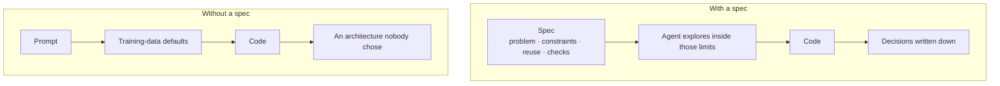
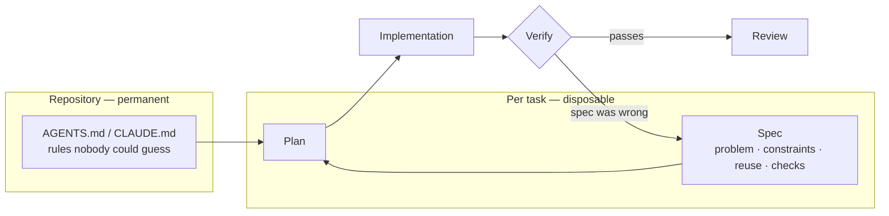
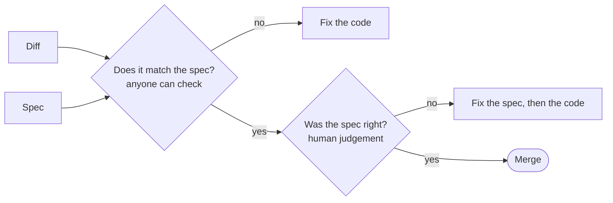

Hay un patrón que se repite cuando un equipo empieza a usar agentes en serio: la velocidad sube, y a los dos meses nadie sabe por qué el código es como es. El commit dice «implementa X». El PR enlaza a un ticket de dos líneas. La conversación donde se decidieron las cosas importantes ya no existe.

El problema no es la IA. Es que **el prompt se convirtió en la especificación**, y un prompt no es un artefacto: es una conversación efímera.

## Por qué la fase de especificación deja de ser opcional

Con desarrollo manual, el diseño queda implícito en el código y se puede reconstruir leyéndolo, porque quien lo escribió tomaba las decisiones línea a línea. Con un agente, esa reconstrucción falla por dos motivos.

El agente genera mucho código coherente muy rápido, así que el volumen no marca dónde estaba la decisión difícil. Y elige por defecto lo más común en su distribución de entrenamiento, que no tiene por qué ser lo correcto en tu repositorio. Sin una especificación, esas elecciones por defecto se convierten en la arquitectura, y nadie decidió nada.



## Qué contiene una especificación útil

No un documento de diseño de veinte páginas. Una página, con cuatro cosas que un agente no puede inventar:

**Qué problema resuelve y para quién.** Una frase. Si no cabe en una frase, probablemente son dos tareas.

**Las restricciones que no son negociables.** Compatibilidad hacia atrás, presupuesto de rendimiento, requisitos de accesibilidad, la librería que hay que usar porque el resto del repositorio la usa.

**Qué existe ya y hay que reutilizar.** Es lo que más devuelve. Un agente que no sabe que ya tienes un resolver de traducciones escribirá otro.

**Cómo se comprueba que está bien.** Comandos concretos, y qué debe ocurrir al ejecutarlos.

Para una funcionalidad pequeña de este sitio, cabe entera en una pantalla:

```md title="specs/reading-time.md"
# Reading time on blog posts

**Problem.** Readers can't tell a two-minute note from a twenty-minute guide.

**Constraints.**
- Both locales. The label goes through `useT()`, never a string literal.
- Computed at build time: no extra work in the visitor's browser.

**Reuse.** `parseFrontmatter` already strips the YAML; count words after it.

**Check.**
- `npx vitest run tests/unit/content` passes.
- `/en/blog/<slug>` and `/es/blog/<slug>` show the time next to the date.
```

Y lo que deliberadamente **no** lleva: cómo implementarlo. Si la especificación dicta la implementación, has escrito el código en prosa y has perdido lo único que el agente hace mejor que tú, que es explorar el espacio de soluciones rápido.

## El ciclo

```steps loop="La implementación corrige la especificación"
Especificar: Una página: el problema, las restricciones, qué reutilizar y cómo comprobarlo.
Planificar: El agente propone un enfoque. Corriges el plan, no el código.
Implementar: El agente escribe el código siguiendo el plan y las reglas del repositorio.
Verificar: Tests, type-check y los comandos que nombraba la especificación. Ejecutable, no sensaciones.
Revisar: ¿Hizo lo que decía la especificación? ¿Era correcta la especificación?
```



> [!TIP]
> Cuando el plan resulta equivocado a mitad de camino, para y corrige el documento. Seguir improvisando es la forma de que el descubrimiento acabe viviendo sólo en un diff.

| Vive en | Cambia | Ejemplo |
| --- | --- | --- |
| `AGENTS.md` | Rara vez | Aquí `md:` es 650px, no 768px |
| Especificación | En cada tarea | «Mantener funcionando el endpoint v1» |
| Código | Constantemente | Cómo se hace de verdad |

La flecha de vuelta es la parte que todo el mundo omite y la que da valor. Casi siempre, implementar revela que la especificación era incorrecta: una restricción que no se sostiene, un caso que nadie consideró, una suposición falsa. Si ese descubrimiento sólo vive en el diff, la siguiente persona lo vuelve a descubrir.

En la práctica la disciplina es sencilla: cuando el plan resulta equivocado a mitad de la implementación, se para y se corrige el documento, no se sigue improvisando.

## El repositorio como especificación permanente

Hay una parte de la especificación que no cambia por tarea: cómo funciona este repositorio en concreto. Eso vive en `AGENTS.md` o `CLAUDE.md`, y el criterio para incluir algo es exacto: **¿puede descubrirlo leyendo el código?** Si sí, sobra.

Lo que sí merece estar es lo que parece una cosa y es otra. En este mismo sitio, los breakpoints de Tailwind están redefinidos —`md:` es 650px, no 768— así que cualquier fragmento copiado de la documentación apunta al viewport equivocado. Ningún modelo lo va a adivinar, porque en el 99% de los proyectos `md:` es 768.

Esa distinción —especificación permanente en el repositorio, especificación por tarea en un documento— es lo que evita que el fichero de reglas crezca hasta que nadie lo lee.

## Qué cambia en la revisión

Con una especificación escrita, la revisión responde dos preguntas separables en lugar de una difusa:

1. **¿Hace lo que la especificación decía?** Comprobable por cualquiera, incluido otro agente, comparando diff y documento.
2. **¿Era correcta la especificación?** Requiere criterio humano, y es la pregunta que de verdad importa.



Sin especificación, las dos se colapsan en «¿me parece bien este código?», que es la forma de revisión que más deja pasar.

## Lo que no arregla

Ser honesto con esto importa.

> [!IMPORTANT]
> Una especificación no impide que el agente escriba código incorrecto; impide que escriba código *inesperado*. Sigues necesitando tests, revisión adversarial y verificación ejecutable.

Y tiene un coste real: escribir la especificación lleva tiempo, y para un cambio de cinco líneas es ceremonia pura. El umbral que uso es sencillo: si voy a tener que explicar esta decisión dentro de seis meses, la escribo ahora.
