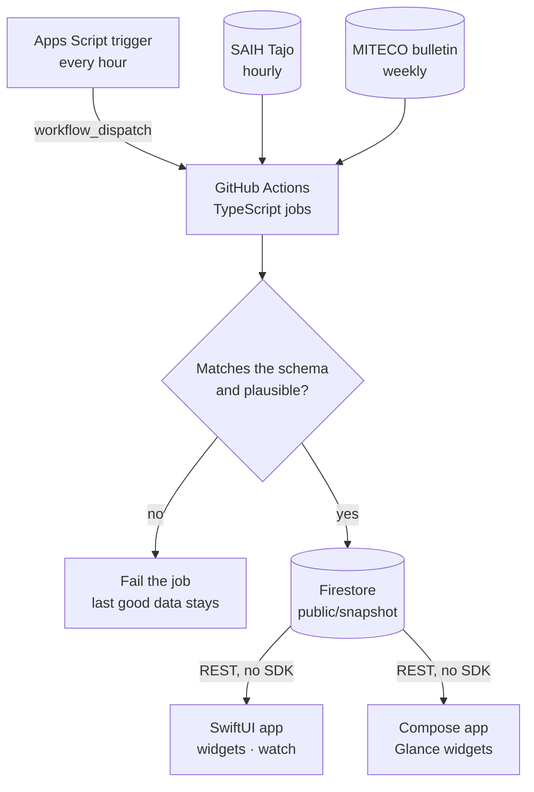
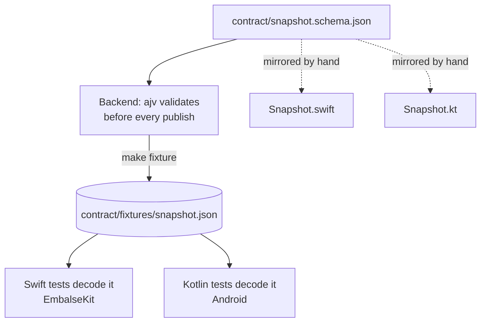
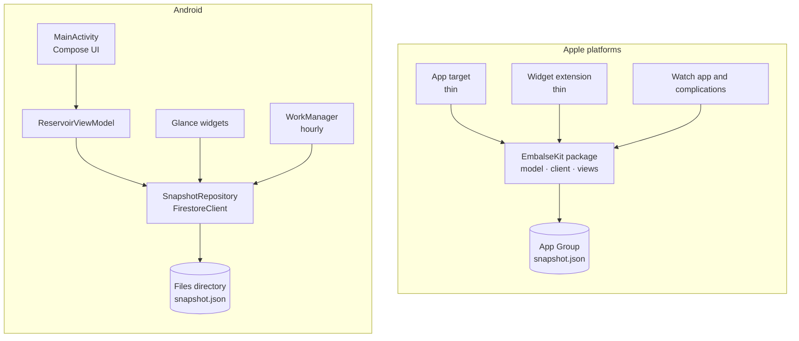

Embalse San Juan responde a una sola pregunta: ¿cuánta agua hay ahora mismo en el embalse de San Juan, en el río Alberche, en Madrid? Está en el App Store para iPhone, iPad y Apple Watch, con widgets en los que el agua sube y baja con el nivel real, y la versión de Android está en pruebas en Google Play.

Son dos apps, escritas dos veces: SwiftUI en las plataformas de Apple y Jetpack Compose en Android. No comparten Swift, ni Kotlin, ni ningún *framework*. Lo que comparten es un **contrato de datos**, y este artículo va de por qué eso resultó ser lo correcto para compartir en esta app, de cómo modela cada plataforma la misma pantalla y de qué fue fácil y qué difícil en cada lado. El código está [abierto en GitHub](https://github.com/lucferbux/embalse-san-juan); los fragmentos son reales y están recortados.

## La forma del sistema

Los datos oficiales ya eran públicos, repartidos por dos webs técnicas: el SAIH Tajo, la telemetría horaria de la Confederación Hidrográfica, y el boletín hidrológico semanal de MITECO. Todo el backend de la app es una forma de recogerlos con un horario, comprobarlos y publicar un documento para que lo lean las apps. Funciona en planes gratuitos y no cuesta nada.



Dos cosas de ese diagrama no estaban en la primera versión.

**El disparador.** El primer diseño era un *workflow* programado de GitHub Actions que escribía en Firestore con el plan Spark, porque Cloud Functions necesita el plan Blaze, que pide una tarjeta y podría generar cargos si algo saliera mal. En Spark, pasarse de una cuota devuelve errores, no una factura. Pero el disparador `schedule` de GitHub resultó ser irregular en este repositorio: GitHub [documenta que las ejecuciones programadas pueden retrasarse cuando hay carga, y algunas descartarse](https://docs.github.com/en/actions/reference/workflows-and-actions/events-that-trigger-workflows), y en la práctica el trabajo horario se ejecutó dos veces donde se esperaban unas diez, con un hueco de seis horas y media. Ahora un disparador horario de Google Apps Script llama a `workflow_dispatch` para cada trabajo y me manda un correo, como mucho una vez al día, si los datos publicados tienen más de tres horas. Las dos decisiones son ADR en el repositorio, con los números.

**La guarda.** Antes de escribir nada, `validate.ts` comprueba la instantánea contra el JSON Schema y contra la física: un volumen dentro de lo que puede medir el sensor de la presa, un porcentaje entre 0 y 100, ninguna lectura del futuro, ningún salto inverosímil desde la hora anterior, y que volumen y porcentaje cuadren entre sí, ya que el SAIH los publica como señales separadas. Si falla cualquier comprobación, no se escribe nada y el trabajo falla. Las apps nunca ven datos malos; ven datos buenos un poco antiguos, marcados como desfasados a partir de seis horas.

## El contrato es el código compartido

`contract/snapshot.schema.json` describe todo lo que necesitan las apps y los widgets para una actualización normal: la lectura actual, las últimas horas, 90 puntos diarios, el tiempo en la presa, el bloque semanal de MITECO, los embalses vecinos y las fuentes. Lo leen tres partes, y ninguna es su dueña.



El truco es el *fixture*. Lo genera el backend y lo valida el mismo código que protege producción, y después los tests unitarios de las dos apps decodifican exactamente ese fichero. Si alguien cambia la salida del backend, el esquema también tiene que cambiar (tiene `additionalProperties: false`), y si el esquema cambia de una forma que el modelo de Swift o de Kotlin no sigue, falla un test en ese lado. Los dos modelos están escritos a mano, y se parecen muchísimo:

```swift title="ios/EmbalseKit/Sources/EmbalseKit/Model/Snapshot.swift"
/// Swift view of `contract/snapshot.schema.json`. Tests decode the same fixture the backend validates.
public struct Snapshot: Codable, Sendable, Equatable {
    public var schemaVersion: Int
    public var generatedAt: Date
    public var live: Live
    public var weekly: Weekly
    // …
    /// AEMET's forecast, added in 2.0 and absent whenever AEMET is unavailable (ADR 4).
    public var forecast: Forecast?
}
```

```kotlin title="android/app/src/main/java/…/data/Snapshot.kt"
/** Kotlin view of contract/snapshot.schema.json. Tests decode the same fixture the backend validates. */
@Serializable
data class Snapshot(
    val schemaVersion: Int,
    val generatedAt: String,
    val live: Live,
    val weekly: Weekly,
    // …
    /** AEMET's forecast, optional in the contract (ADR 0004). */
    val forecast: Forecast? = null,
)

val contractJson = Json { ignoreUnknownKeys = true }
```

Ese `ignoreUnknownKeys`, y que el `Codable` de Swift ignore por defecto las claves desconocidas, es lo que permite que el contrato evolucione. La versión 1.0 está instalada en teléfonos que no se van a actualizar todos, y las dos apps 1.0 rechazan cualquier `schemaVersion` distinto de 1. Así que la regla, escrita como ADR, es que mientras la 1.0 esté en las tiendas el esquema solo crece con **campos opcionales**: no se quita, renombra, hace anulable ni cambia de significado nada. Los datos nuevos que no pertenecen a la instantánea van en documentos nuevos que la 1.0 nunca lee. La previsión de AEMET fue el primer añadido; las apps antiguas no saben que existe y siguen funcionando.

> [!TIP]
> Un *fixture* compartido que decodifican todos los clientes es el test de contrato más barato que conozco. No necesita ningún *framework* y falla en el lado que se ha desviado.

## Leer Firestore sin Firestore

Las apps no enlazan el SDK de Firebase. La regla del repositorio da el motivo: los widgets tienen límites de memoria estrictos, y una extensión de widgets es justo el proceso que más a menudo lee estos datos. Firestore tiene una [API REST](https://firebase.google.com/docs/firestore/use-rest-api) a la que pueden llamar clientes sin autenticar, y son las reglas de seguridad las que deciden qué pueden leer; aquí las reglas dejan `public/*` legible para cualquiera y todo lo demás cerrado.

El formato de documento de la API REST es verboso (cada valor va envuelto en un objeto con su tipo), así que el backend guarda el JSON del contrato como un único campo de texto llamado `payload`. Cada cliente desenvuelve un campo y decodifica JSON normal:

```swift title="ios/EmbalseKit/Sources/EmbalseKit/Data/FirestoreClient.swift"
/// Documents hold the contract JSON in one string field, `payload`.
static func decodePayload<T: Decodable>(_ data: Data) throws -> T {
    let envelope = try JSONDecoder().decode(Envelope.self, from: data)
    guard let payload = envelope.fields?.payload?.stringValue?.data(using: .utf8) else {
        throw ClientError.missingPayload
    }
    return try makeDecoder().decode(T.self, from: payload)
}
```

El `FirestoreClient` de Kotlin hace lo mismo con `HttpURLConnection` y kotlinx.serialization: unas cuarenta líneas en cada lado, sin dependencias. Los dos guardan en disco la última instantánea buena (en iOS, en el contenedor del App Group, para que la app y los widgets la compartan) y recurren a ella cuando falla la red. Solo lanzan un error cuando no hay absolutamente nada que mostrar.

## La misma pantalla, dos modelos de estado

Aquí es donde las plataformas difieren en sintaxis y coinciden en forma. Las dos apps tienen un objeto que es dueño del estado del embalse, arranca con la instantánea en caché, se niega a volver a pedir datos más de una vez cada 15 minutos (los datos nuevos llegan cada hora) y recarga los widgets solo cuando ha cambiado `generatedAt`.

En iOS es una clase [`@Observable`](https://developer.apple.com/documentation/observation) en el *main actor*, que la `App` guarda en `@State`:

```swift title="ios/EmbalseKit/Sources/EmbalseKit/Data/ReservoirModel.swift" {1-2,9}
@MainActor
@Observable
public final class ReservoirModel {
    public enum State {
        case loading
        case loaded(Snapshot, SnapshotRepository.Origin)
        case failed
    }
    public private(set) var state: State = .loading

    public func refresh(force: Bool = false) async {
        // … skip if refreshed in the last 15 minutes
        do {
            let result = try await repository.load()
            state = .loaded(result.snapshot, result.origin)
            if result.snapshot.generatedAt != previous {
                WidgetCenter.shared.reloadAllTimelines()
            }
        } catch {
            if case .loaded = state { return }
            state = .failed
        }
    }
}
```

En Android es un `ViewModel` que expone un `StateFlow` de una interfaz sellada, recogido en Compose con `collectAsStateWithLifecycle()`, que es lo que la documentación [recomienda para recoger *flows* en Android](https://developer.android.com/develop/ui/compose/state):

```kotlin title="android/app/src/main/java/…/ui/ReservoirViewModel.kt" {1-5,12}
sealed interface UiState {
    data object Loading : UiState
    data object Failed : UiState
    data class Loaded(val snapshot: Snapshot, val origin: SnapshotRepository.Origin) : UiState
}

class ReservoirViewModel(application: Application) : AndroidViewModel(application) {
    private val _state = MutableStateFlow<UiState>(UiState.Loading)
    val state: StateFlow<UiState> = _state

    fun refresh(force: Boolean = false) {
        viewModelScope.launch {
            try {
                val (snapshot, origin) = repository.load()
                _state.value = UiState.Loaded(snapshot, origin)
                if (snapshot.generatedAt != previous) ReservoirWidget.refreshAll(getApplication())
            } catch (_: IOException) {
                if (_state.value !is UiState.Loaded) _state.value = UiState.Failed
            }
        }
    }
}
```

Los mismos tres estados, el mismo «un fallo nunca sustituye a datos que ya tenemos», el mismo aviso a los widgets. La diferencia está en dónde vive la observación. En SwiftUI, la macro `@Observable` hace observable al propio modelo, y una vista [solo se actualiza cuando cambia una propiedad que lee su `body`](https://developer.apple.com/documentation/swiftui/managing-model-data-in-your-app). En Compose, el ViewModel publica un flujo y el *composable* lo convierte en `State` en el borde, así que el código de interfaz solo ve valores. Lado a lado:

| Concepto | SwiftUI | Jetpack Compose |
| --- | --- | --- |
| **Dueño del estado** | Clase `@Observable`, `@MainActor` | `AndroidViewModel` |
| **Quién lo guarda** | `@State` en la `App` | `viewModel()` en el *composable* raíz |
| **Cómo se expone** | Una propiedad `private(set)` | `StateFlow<UiState>` |
| **Cómo lo lee la UI** | Directamente; seguimiento por propiedad | `collectAsStateWithLifecycle()` |
| **Trabajo asíncrono** | Método `async`, `.task` / fase de la escena | `viewModelScope.launch` |
| **Estados de carga** | `enum State` | `sealed interface UiState` |
| **Compartido con widgets** | Fichero en el App Group, paquete `EmbalseKit` | Directorio de ficheros de la app, mismo proceso |
| **Diseño adaptable** | Clases de tamaño y tamaño de ventana | Ancho de ventana, `NavigationSuiteScaffold` |
| **Widgets** | WidgetKit, vistas SwiftUI | Glance, traducido a RemoteViews |
| **Actualización en segundo plano** | Política de recarga de la *timeline* | WorkManager, cada hora |



El lado de iOS tiene una regla estructural más: toda la lógica y las vistas viven en el paquete Swift `EmbalseKit`, y los *targets* de la app, los widgets y el reloj se quedan finos. Eso es lo que permite que el widget de la pantalla de inicio, el de la pantalla de bloqueo y la complicación del reloj dibujen el agua con el mismo código que la tarjeta principal de la app.

## Widgets en los dos

Los widgets son la verdadera puerta de entrada de la app: casi siempre nadie la abre, se mira de reojo la pantalla de inicio. En las dos plataformas el widget dibuja el agua del embalse a su nivel real, con la cifra colocada entera dentro del agua (en blanco) o entera en el cielo (en el color de etiqueta), nunca partida por la línea del agua. Esa única regla está implementada dos veces. De WidgetKit en sí, y de App Intents, escribí en [el artículo hermano sobre widgets](/blog/widgets-app-intents), así que aquí solo lo que cambia.

**iOS.** Los widgets son vistas SwiftUI de `EmbalseKit`, en tamaños de pantalla de inicio hasta el extragrande del iPad, accesorios de pantalla de bloqueo, complicaciones del reloj y un control del Centro de Control. Cada *timeline* tiene una entrada y pide recargarse a un minuto fijo de la hora siguiente. Es una petición: decide el sistema, y Apple describe un [presupuesto diario de actualizaciones](https://developer.apple.com/documentation/widgetkit/keeping-a-widget-up-to-date) que, para un widget que se ve a menudo, sale aproximadamente a cada 15 o 60 minutos. Para datos horarios, basta.

**Android.** Glance parece Compose, pero [traduce sus *composables* a RemoteViews](https://developer.android.com/develop/ui/compose/glance/build-ui), y eso trae los límites de RemoteViews. Glance no puede dibujar libremente, así que el cielo y el agua son un mapa de bits que el widget pinta a su propio tamaño, con el texto encima. Y usa `SizeMode.Exact`, que vuelve a crear el contenido cada vez que cambia el tamaño, porque el margen que mantiene la cifra lejos de la línea del agua se mide en dp del widget real:

```kotlin title="android/app/src/main/java/…/widget/ReservoirWidget.kt"
object WidgetPlacement {
    fun decide(usable: Float, water: Float, full: Float, compact: Float): Pair<Boolean, Boolean> {
        fun fitsWater(block: Float) = water >= block + 12f + 4f + 10f
        fun fitsSky(block: Float) = usable - water - 12f - 4f >= block
        return when {
            fitsWater(full) -> true to false
            fitsSky(full) -> false to false
            fitsWater(compact) -> true to true
            fitsSky(compact) -> false to true
            else -> (water >= usable - water) to true
        }
    }
}
```

La actualización es un `PeriodicWorkRequest` cada hora mientras haya un widget colocado, que se cancela al quitar el último. El [intervalo mínimo de WorkManager es de 15 minutos](https://developer.android.com/topic/libraries/architecture/workmanager/how-to/define-work), y una hora queda holgadamente por encima.

## Qué fue fácil y qué difícil

No es una clasificación, solo dónde se fue el tiempo en cada lado, según las auditorías y los ADR del repositorio.

**Fácil en iOS:** un solo paquete que alimenta la app, los widgets, la pantalla de bloqueo y el reloj, así que un cambio de diseño en la tarjeta del agua llegaba a todas las superficies a la vez. La caché del App Group permitía a los widgets enseñar la última instantánea sin hacer una petición propia. La app del reloj pide los datos por su cuenta, sin el iPhone, con el mismo cliente.

**Difícil en iOS:** el trabajo en segundo plano que no puedes prometer. Los avisos que estoy preparando para la próxima versión (el nivel cruzando un umbral que elige el usuario) son notificaciones locales, porque las *push* necesitarían *tokens* de dispositivo y un servidor que los guarde, y eso rompería la promesa de privacidad. En iOS la comprobación corre en `BGAppRefreshTask`, que es de mejor esfuerzo: el sistema puede saltársela durante horas. El ADR lo dice claro: la app tiene que avisar de que las alertas pueden llegar tarde. El texto grande fue lo otro: la revisión de diseño encontró la fuente y la fecha cortadas en los tamaños más grandes, lo que rompe la regla de que cada cifra muestre ambas.

**Fácil en Android:** WorkManager. El trabajo horario mientras hay un widget colocado es lo bastante fiable como para prometer «en una hora, más o menos» en los avisos, cosa que iOS no puede. El `NavigationSuiteScaffold` de Material 3 cambia entre barra inferior y *rail* según el tamaño de ventana sin puntos de corte escritos a mano.

**Difícil en Android:** los límites de dibujo de Glance (de ahí el mapa de bits) y el color dinámico. Material You toma los colores de la interfaz del fondo de pantalla, que es lo correcto para la app, pero en la primera versión el agua también cogía el `primary` dinámico y salía lavanda. Ahora el agua es el único color fijo, como los datos que muestra. Y la distribución: la producción en Google Play exige antes una prueba cerrada con al menos 12 testers durante 14 días, que es por lo que Android sigue en pruebas.

> [!NOTE]
> La auditoría de Android tenía un hallazgo que resume todo el enfoque: el diseño cambiaba según un ancho de pantalla fijo en el código. Ahora las dos apps deciden el diseño por tamaño de ventana o clase de tamaño, nunca por tipo de dispositivo, y eso es lo que hizo que la pantalla dividida del iPad y los plegables funcionaran sin casos especiales.

## Por qué no Kotlin Multiplatform ni Flutter

Nunca escribí un ADR descartándolos, así que no me voy a inventar uno a posteriori. Lo que sí dice el repositorio basta para explicar la decisión.

Los principios de la especificación dicen **nativo**: componentes del sistema en cada plataforma, Dynamic Type, modo oscuro y Material You. Las reglas dicen **nada de SDK de Firebase en las apps**, por la memoria de los widgets, lo que ya redujo la capa de datos a un cliente REST pequeño. Y la superficie del producto es sobre todo superficie de plataforma: familias de WidgetKit, accesorios de pantalla de bloqueo, complicaciones del reloj, un control del Centro de Control, widgets de Glance, WorkManager. Son justo las partes que una capa compartida no escribiría por mí.

Lo que se habría compartido es la parte que ya es pequeña: decodificar un documento JSON y un puñado de reglas. En su lugar comparto la definición de ese documento, y los dos lados se prueban contra el mismo fichero.

## Lo que cuesta

La lista honesta:

- **La lógica existe dos veces.** La regla de las seis horas para marcar datos desfasados, el texto de la tendencia, el formato de los números y la regla de colocación de la cifra están escritos en Swift y en Kotlin y se prueban por separado. Coinciden porque yo me encargo de que coincidan, no porque lo compruebe un compilador.
- **Las funcionalidades llegan de forma desigual.** iOS tiene los widgets de comparación con MITECO y del río; Android todavía no. Las propinas son solo de iOS, porque Android necesitaría Google Play Billing. Una capa de interfaz compartida no arreglaría eso, pero sí significa que cada funcionalidad son dos trabajos.
- **Los modelos se copian a mano.** El *fixture* detecta desviaciones en lo que se decodifica, no un campo que un lado olvidó declarar como opcional. Generar los tipos de Swift y Kotlin a partir del esquema es lo siguiente que probaría.
- **El backend depende de una fuente sin contrato publicado.** El JSON del SAIH no está documentado; `make live-check` es lo que me dice que sigue funcionando.

Para una app de una pantalla con mucha superficie de plataforma, compartir un contrato en lugar de código fue la medida justa. Para una app con mucha lógica de negocio y poca integración con la plataforma, lo pensaría de otra forma.

## Para seguir aprendiendo

- [Using the Cloud Firestore REST API](https://firebase.google.com/docs/firestore/use-rest-api) — cómo funcionan las lecturas sin autenticar y cómo se les aplican las reglas de seguridad.
- [Observation](https://developer.apple.com/documentation/observation) — el *framework* que hay detrás de `@Observable`.
- [Managing model data in your app](https://developer.apple.com/documentation/swiftui/managing-model-data-in-your-app) — cómo SwiftUI sigue solo las propiedades que lee una vista.
- [State and Jetpack Compose](https://developer.android.com/develop/ui/compose/state) — *state hoisting*, contenedores de estado y `collectAsStateWithLifecycle()`.
- [Build UI with Glance](https://developer.android.com/develop/ui/compose/glance/build-ui) — `SizeMode`, y qué supone para el diseño traducir a RemoteViews.
- [Keeping a widget up to date](https://developer.apple.com/documentation/widgetkit/keeping-a-widget-up-to-date) — el presupuesto de actualizaciones de WidgetKit, en palabras de Apple.
- [Define work requests (WorkManager)](https://developer.android.com/topic/libraries/architecture/workmanager/how-to/define-work) — trabajo periódico, intervalos y restricciones.
- [Embalse San Juan en GitHub](https://github.com/lucferbux/embalse-san-juan) — el contrato, el backend, las dos apps y los ADR citados aquí.
