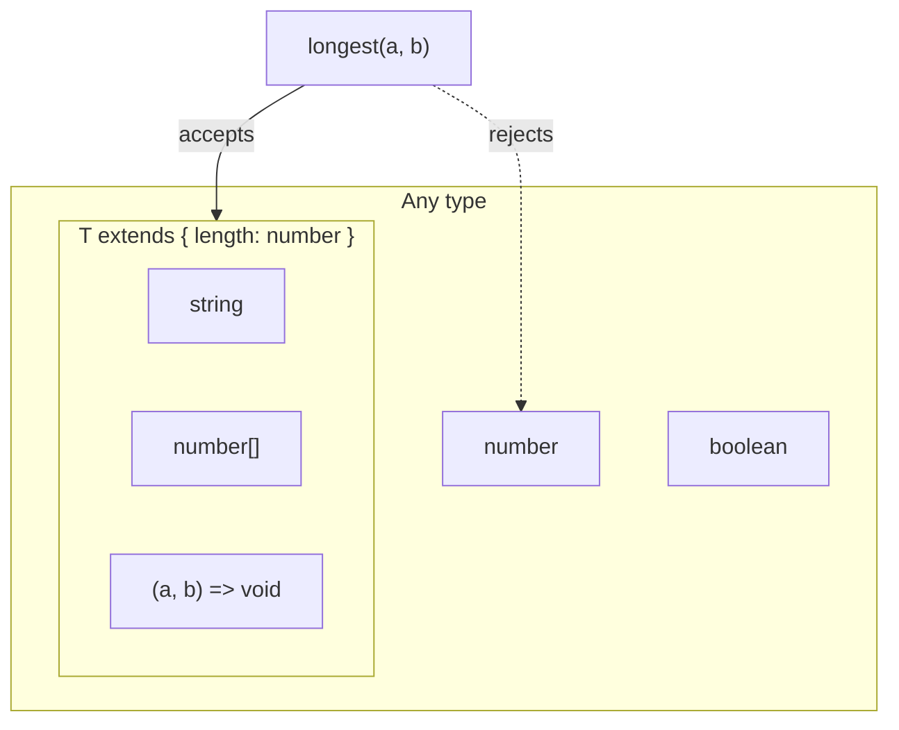
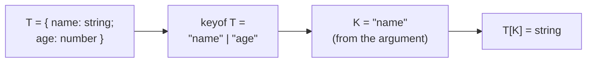
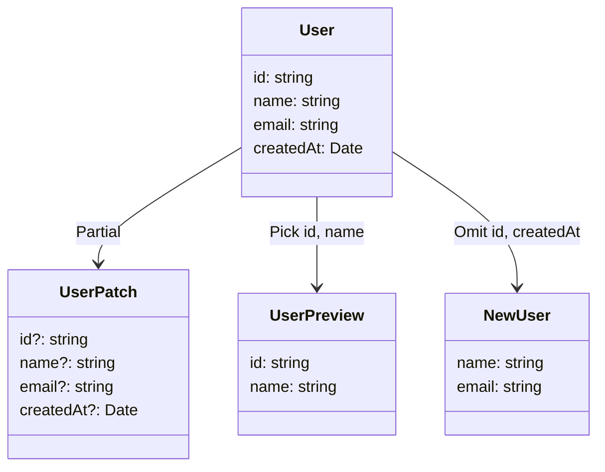
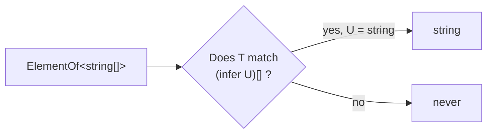

Un genérico no es «un tipo que no sé todavía». Es una **relación** entre tipos. Esa diferencia es la que separa el código que usa TypeScript del que lo sufre.

## El problema que resuelven

Esta función es correcta y completamente inútil desde el punto de vista de los tipos:

```ts
function first(items: any[]): any {
  return items[0];
}

const n = first([1, 2, 3]); // any
n.toUpperCase();            // compiles, explodes at runtime
```

`any` apaga el compilador. `unknown` es más honesto pero obliga a comprobar en cada uso. Lo que queremos decir es otra cosa: *el tipo que devuelvo es el mismo que contiene el array que me das*.

```ts
function first<T>(items: T[]): T | undefined {
  return items[0];
}

const n = first([1, 2, 3]);       // number | undefined
const s = first(["a", "b"]);      // string | undefined
```

No hemos anotado nada en las llamadas. TypeScript **infiere** `T` a partir del argumento. Ese es el objetivo: escribir la relación una vez y que el compilador la propague.

## Restringir con `extends`

Un genérico sin restricciones no te deja hacer nada con el valor, porque podría ser cualquier cosa. `extends` acota el conjunto.

```ts {1,7}
function longest<T extends { length: number }>(a: T, b: T): T {
  return a.length >= b.length ? a : b;
}

longest("hello", "goodbye");  // string
longest([1, 2], [1, 2, 3]);   // number[]
longest(1, 2);                // Error: number has no length
```



El caso que más rendimiento da en el día a día es restringir a las claves de un objeto:

```ts {1}
function get<T, K extends keyof T>(obj: T, key: K): T[K] {
  return obj[key];
}

const user = { name: "Lucas", age: 34 };
get(user, "name");  // string
get(user, "age");   // number
get(user, "email"); // Error: "email" is not on the object
```

`T[K]` es un *indexed access type*: el tipo de la propiedad `K` dentro de `T`. La función no devuelve «algo del objeto», devuelve exactamente el tipo de esa clave.



## Los utility types son genéricos escritos por otros

`Partial`, `Pick`, `Omit`, `Record` y compañía no son sintaxis especial. Son genéricos normales definidos en la librería estándar, y se pueden leer.

```ts
type Partial<T> = { [K in keyof T]?: T[K] };
```

Eso es todo: recorre las claves de `T` y añade `?`. Los más útiles en la práctica:

```ts
interface User {
  id: string;
  name: string;
  email: string;
  createdAt: Date;
}

// Everything optional — the classic for an edit form
type UserPatch = Partial<User>;

// Only some keys
type UserPreview = Pick<User, "id" | "name">;

// Everything but some — better for fields the client doesn't send
type NewUser = Omit<User, "id" | "createdAt">;

// A dictionary with constrained keys
type UsersById = Record<string, User>;

// Strip null and undefined
type Defined = NonNullable<string | null>; // string
```



La elección entre `Pick` y `Omit` no es de estilo. `Pick` es una lista blanca: si mañana añades un campo a `User`, `UserPreview` no cambia. `Omit` es una lista negra: el campo nuevo aparece automáticamente. Para un DTO que va a la red sueles querer una lista blanca; para «el modelo menos lo que genera el servidor», una lista negra.

| | Pick | Omit |
| --- | --- | --- |
| **Tipo de lista** | Lista blanca | Lista negra |
| **Se añade un campo a `User`** | No aparece | Aparece automáticamente |
| **Uso típico** | DTOs que viajan por la red | «El modelo menos lo que genera el servidor» |

## Tipos condicionales

Un tipo condicional elige en función de otro tipo. La sintaxis imita al operador ternario:

```ts
type IsArray<T> = T extends unknown[] ? true : false;

type A = IsArray<string[]>; // true
type B = IsArray<string>;   // false
```

Con `infer` puedes además *extraer* un tipo de dentro de otro:

```ts
type ElementOf<T> = T extends (infer U)[] ? U : never;

type C = ElementOf<string[]>; // string
```



Así está definido `ReturnType`, que es probablemente el utility type más práctico que existe:

```ts
type ReturnType<T extends (...args: never[]) => unknown> =
  T extends (...args: never[]) => infer R ? R : never;

function buildConfig() {
  return { retries: 3, timeout: 5_000 };
}

type Config = ReturnType<typeof buildConfig>;
// { retries: number; timeout: number }
```

> [!TIP]
> Ese patrón —derivar el tipo de la implementación en lugar de declararlo aparte— es el que evita que tipos y código se desincronicen.

## Reglas prácticas

Tres criterios que uso al revisar código:

**Si un genérico aparece una sola vez en la firma, probablemente no debería ser genérico.** `function log<T>(value: T): void` es exactamente `function log(value: unknown): void`, pero más difícil de leer. Un genérico gana cuando *relaciona* dos posiciones: un parámetro con el retorno, o dos parámetros entre sí.

**Prefiere inferir a declarar.** `typeof`, `ReturnType` y `keyof` derivan tipos del código real. Un tipo escrito a mano junto a su implementación es un tipo que acabará mintiendo.

**`as` no es una conversión, es una promesa.** `value as User` le dice al compilador que confíe en ti sin comprobar nada. Cuando el dato viene de fuera —de una API, de `localStorage`, de un formulario— lo que hace falta no es una aserción sino una validación en runtime; ahí es donde un `type guard` o un esquema tipo Zod hacen el trabajo de verdad.

```ts {1,3}
const user = JSON.parse(raw) as User; // checks nothing at runtime

function isUser(value: unknown): value is User {
  return (
    typeof value === "object" &&
    value !== null &&
    typeof (value as Record<string, unknown>).id === "string" &&
    typeof (value as Record<string, unknown>).email === "string"
  );
}
```
