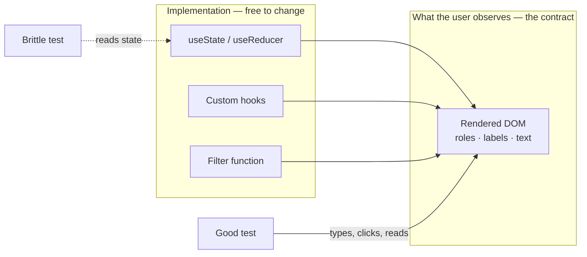
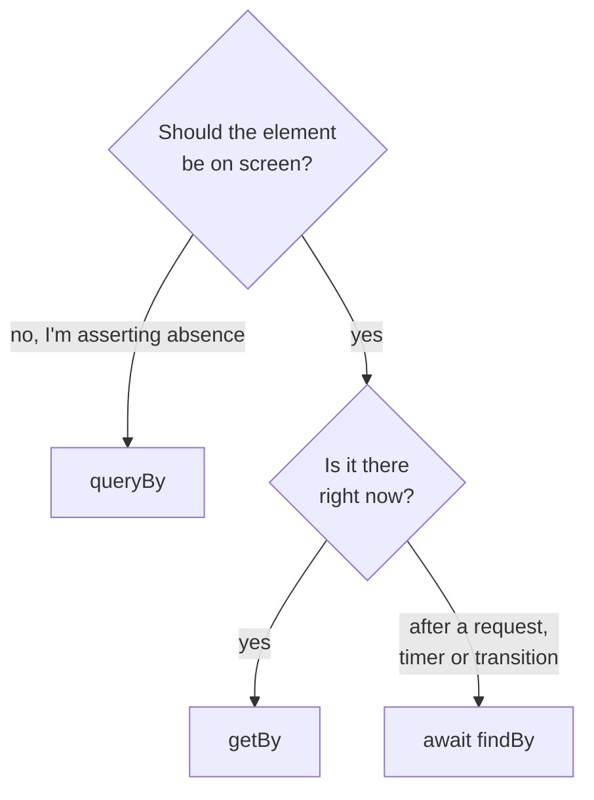
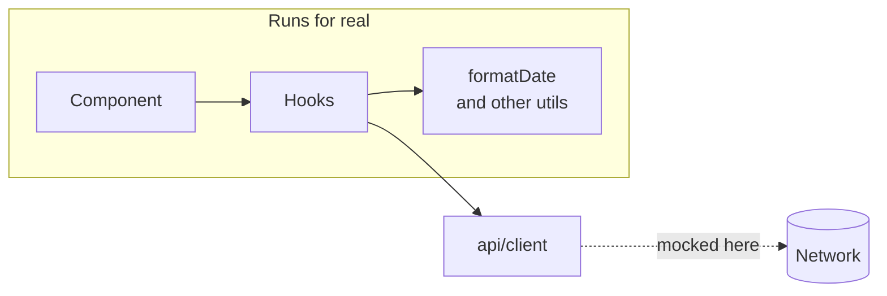

Casi todo el mundo que se queja de que «los tests frenan» tiene la misma suite: tests acoplados a la implementación. Se rompen cuando renombras una función interna, y no se enteran cuando el botón deja de funcionar. Es el peor de los dos mundos.

## La regla que lo cambia todo

> Cuanto más se parezcan tus tests a cómo se usa el software, más confianza te darán.

Es el principio de Testing Library, y no es una frase motivacional: tiene una consecuencia operativa directa. Prueba **lo que el usuario observa**, no cómo está construido.



Un ejemplo. Este componente muestra una lista y permite filtrarla:

```tsx title="src/components/UserList.tsx"
export function UserList({ users }: { users: User[] }) {
  const [query, setQuery] = useState("");
  const visible = users.filter((u) =>
    u.name.toLowerCase().includes(query.toLowerCase())
  );

  return (
    <>
      <label htmlFor="q">Search</label>
      <input id="q" value={query} onChange={(e) => setQuery(e.target.value)} />
      <ul>
        {visible.map((u) => <li key={u.id}>{u.name}</li>)}
      </ul>
    </>
  );
}
```

El test malo mira el estado:

```tsx
// Don't do this
const { result } = renderHook(() => useState(""));
expect(result.current[0]).toBe("");
```

El test bueno hace lo que haría una persona:

```tsx title="tests/UserList.test.tsx" {5,7-8}
it("filters by name", async () => {
  const user = userEvent.setup();
  render(<UserList users={[{id:"1",name:"Ana"},{id:"2",name:"Luis"}]} />);

  await user.type(screen.getByLabelText("Search"), "an");

  expect(screen.getByText("Ana")).toBeInTheDocument();
  expect(screen.queryByText("Luis")).not.toBeInTheDocument();
});
```

Si mañana cambias `useState` por `useReducer`, o mueves el filtrado a un hook, este test sigue pasando. Y si rompes el filtrado, falla. Eso es exactamente lo que quieres de un test.

## `getBy`, `queryBy`, `findBy`

Las tres familias de consultas no son intercambiables y elegir mal produce tests que fallan de forma confusa:

| Familia | Si no lo encuentra | Asíncrona | Para qué |
| --- | --- | --- | --- |
| **`getBy`** | Lanza, con un volcado del DOM muy útil | No | Lo espero ahora y debe existir |
| **`queryBy`** | Devuelve `null` | No | Puede no existir. **Es la única válida para afirmar ausencia** |
| **`findBy`** | Rechaza al agotar el timeout | Sí — reintenta | Aparecerá pronto. Para todo lo asíncrono |



```tsx {2}
expect(screen.queryByText("Error")).not.toBeInTheDocument();  // right
expect(screen.getByText("Error")).not.toBeInTheDocument();    // never passes: getBy already threw

expect(await screen.findByText("Saved")).toBeInTheDocument(); // after a request
```

> [!CAUTION]
> `getBy` dentro de una aserción con `.not` no puede pasar nunca: si el elemento no está, `getBy` lanza antes de que `expect` llegue a verlo. La ausencia siempre es `queryBy`.

## El orden de prioridad de las consultas

Testing Library ordena sus consultas a propósito, y ese orden es una herramienta de accesibilidad disfrazada de API de testing:

1. `getByRole` — lo que usa un lector de pantalla. `getByRole("button", { name: /save/i })`.
2. `getByLabelText` — para campos de formulario.
3. `getByText` — para contenido no interactivo.
4. `getByTestId` — último recurso.

Cuando no consigues seleccionar un botón por su rol y su nombre accesible, el test te está diciendo que ese botón tampoco es alcanzable para alguien con un lector de pantalla. Arreglar el test arregla la accesibilidad. Por eso `getByTestId` es una derrota pequeña: funciona, pero has silenciado la señal.

Un caso típico: un botón que sólo tiene un icono. `getByRole("button", { name: /delete/i })` falla, y el arreglo está en el componente, no en el test:

```diff
- <button onClick={onDelete}><TrashIcon /></button>
+ <button onClick={onDelete} aria-label="Delete"><TrashIcon /></button>
```

## Qué mockear y qué no

La regla que uso: **mockea la frontera del sistema, no las piezas de dentro**.



```tsx
// Good: the network is a boundary
vi.mock("@/api/client", () => ({ fetchUsers: vi.fn() }));

// Bad: formatDate is yours, it's pure, it's fast
vi.mock("@/utils/formatDate");
```

Mockear utilidades internas convierte el test en una descripción de tu propio código, y entonces el refactor lo rompe sin que nada haya dejado de funcionar.

## Cobertura: una señal, no un objetivo

La cobertura sólo sabe responder «¿se ejecutó esta línea?». No sabe si comprobaste algo. Este test da 100% de cobertura y no verifica nada:

```tsx
it("renders", () => {
  render(<Checkout total={100} />);
});
```

Por eso un umbral global del 90% suele producir tests basura escritos para subir el número. Un 70% global con umbrales altos donde vive la lógica —utilidades, hooks, reducers— dice mucho más. Lo útil de la cobertura no es el porcentaje: es abrir el informe y encontrar la rama de error que nunca nadie probó.

En Vitest, ese reparto son unas pocas líneas de configuración:

```ts title="vitest.config.ts" {5-6}
export default defineConfig({
  test: {
    coverage: {
      thresholds: {
        lines: 70,
        "src/utils/**": { lines: 95, branches: 90 },
      },
    },
  },
});
```

## Un test que falla cuando debe

La última comprobación, y la que casi nadie hace: **rompe el código a propósito y confirma que el test falla**. Un test que nunca ha fallado no ha demostrado nada.

```steps
Escribe el test: Ejecútalo y míralo ponerse en verde.
Rompe el código: Comenta la línea de la que trata el test.
Míralo fallar: Rojo, con un mensaje que apunta a la causa.
Restaura: Vuelve a poner la línea. Ahora el verde significa algo.
```

Con el filtro de arriba, el sabotaje es una línea:

```diff title="src/components/UserList.tsx"
  const visible = users.filter((u) =>
-   u.name.toLowerCase().includes(query.toLowerCase())
+   true // sabotage: the "filters by name" test must now fail
  );
```

> [!TIP]
> Yo lo hago siempre al escribir el primer test de un módulo, y me ha ahorrado más de una suite verde que no comprobaba absolutamente nada.
