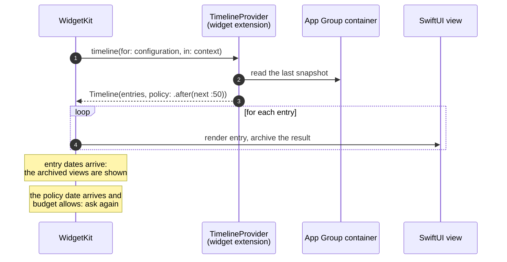
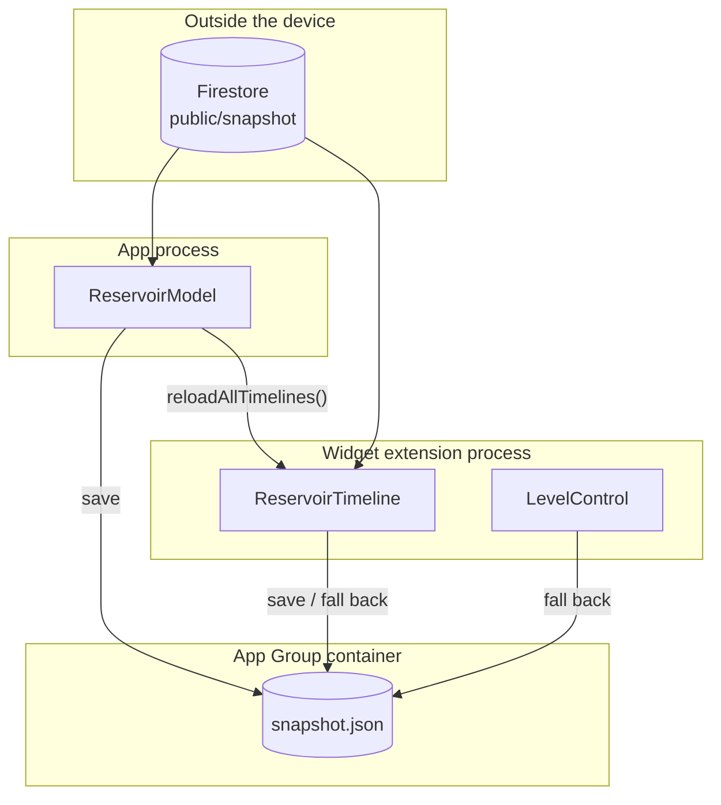
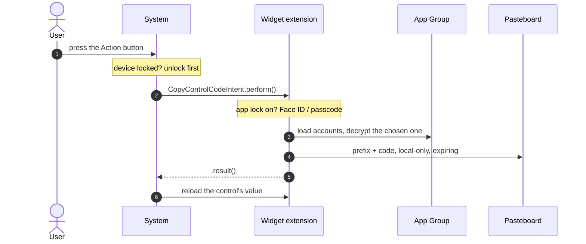
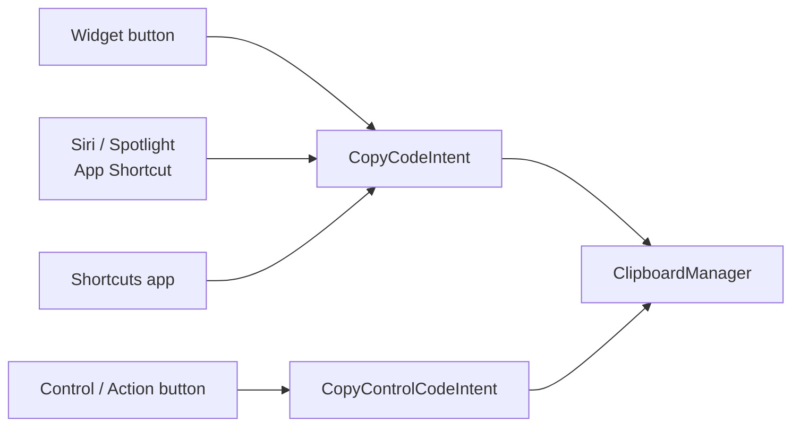

Tengo dos apps de iOS en la App Store cuya pantalla más usada no está dentro de
la app.

**Embalse San Juan** muestra el estado en directo del embalse de San Juan, en el
río Alberche, cerca de Madrid. Un recolector publica datos oficiales cada hora, y
los widgets dibujan el agua a su nivel real: cuando el embalse está al 48 %, el
azul llena el 48 % del widget, con una ola encima. **TOTP Password** es un
autenticador de doble factor: sus widgets muestran códigos con una cuenta atrás,
un toque copia el código (con un prefijo fijo tipo PIN, si la cuenta lo tiene) y
un control del Centro de control hace lo mismo desde cualquier sitio, también
desde el botón de Acción.

Las dos se apoyan en los mismos tres *frameworks* (WidgetKit, App Intents y App
Groups) y las dos me enseñaron que un widget es algo muy distinto de una vista
pequeña. Este artículo recorre cómo los usan de verdad, con código recortado de
los proyectos reales.

## Un widget es una línea de tiempo, no una vista que se ejecuta

Lo primero que hay que desaprender: el código de tu widget no se ejecuta mientras
está en pantalla. WidgetKit le pide a tu extensión una **línea de tiempo**
(*timeline*): un array de entradas, cada una con una fecha. Renderiza la vista de
SwiftUI de cada entrada por adelantado y archiva el resultado. Cuando llega la
fecha de una entrada, el sistema pone la vista ya renderizada. Tu proceso puede
llevar rato muerto.



Todo lo demás se deduce de ese modelo. No puedes tener un temporizador, no puedes
animar a tu ritmo y no puedes descargar datos en el momento en que el usuario
mira. Lo que sí puedes hacer es predecir.

## Compartir datos: el App Group es el contrato

La app y la extensión del widget son procesos distintos con *sandboxes* distintos.
Un [App Group](https://developer.apple.com/documentation/xcode/configuring-app-groups)
les da un contenedor compartido (un directorio, más una suite de `UserDefaults`
compartida) y ese contenedor es la única interfaz entre ellos.



En Embalse San Juan el contrato es un fichero. Los dos procesos pasan por el
mismo repositorio, que descarga de Firestore y guarda la última instantánea buena
en el contenedor del grupo, así que un widget sin red sigue mostrando la última
cifra (con su fecha, y un aviso de dato antiguo pasadas seis horas):

```swift title="ios/EmbalseKit/Sources/EmbalseKit/Data/SnapshotRepository.swift" {8,21-22}
/// Keeps the last good snapshot in the App Group, so the app and widgets share it and work offline.
public struct SnapshotCache: Sendable {
    public static let appGroup = "group.…" // identifier trimmed
    let fileURL: URL

    public init(directory: URL? = nil) {
        let root = directory
            ?? FileManager.default.containerURL(forSecurityApplicationGroupIdentifier: Self.appGroup)
            // Unsigned test builds have no App Group.
            ?? FileManager.default.urls(for: .cachesDirectory, in: .userDomainMask)[0]
        fileURL = root.appending(path: "snapshot.json")
    }
    // … load() and save(_:) read and write JSON atomically
}

public struct SnapshotRepository: Sendable {
    // …
    /// Falls back to the last saved snapshot. Only throws when there is nothing to show at all.
    public func load() async throws -> Result {
        do {
            let snapshot = try await fetch()
            cache.save(snapshot)
            return Result(snapshot: snapshot, origin: .network)
        } catch {
            guard let cached = cache.load() else { throw error }
            return Result(snapshot: cached, origin: .cache)
        }
    }
}
```

El contrato de TOTP es más delicado, porque lo que comparte es secreto. Las
cuentas viven en los `UserDefaults` del grupo, cada secreto sellado con
ChaChaPoly. La clave vive en el Llavero de iCloud, y se refleja una copia en un
fichero del contenedor del grupo para que el widget y la extensión de
Autorrelleno puedan leerla. La regla escrita al principio de
`EncryptionKeyManager` es la que más me importa: las extensiones solo *leen* la
clave. Crear una nueva porque la antigua no se podía leer en ese momento dejaría
huérfanas todas las cuentas existentes. Así que el cargador del widget es de
solo lectura, y tiene estados para los casos en que no puede leer:

```swift title="TOTP Widget/TOTP_Widget.swift"
static func load() -> (accounts: [OtpModel], state: CodesEntry.State) {
    // Checked first, so a locked app's secrets aren't even decrypted in the widget process
    guard !AppPreferences.appLockEnabled else { return ([], .locked) }
    guard EncryptionKeyManager.existingKey() != nil else { return ([], .unavailable) }
    let accounts = AccountQuery.models()
    return (accounts, accounts.isEmpty ? .noAccounts : .ready)
}
```

`.unavailable` es el estado tras un reinicio, antes del primer desbloqueo, cuando
la protección de datos mantiene cerrado el contenedor. `.locked` es el bloqueo de
la propia app: un widget no puede pedir Face ID, así que con el bloqueo activado
no muestra ningún código.

> [!IMPORTANT]
> App Groups, CloudKit y compartir el Llavero necesitan un equipo de firma e
> identificadores aprovisionados. En una compilación sin firmar en el simulador,
> el contenedor del grupo es `nil`, y por eso `SnapshotCache` recurre al directorio
> de cachés en vez de fallar. No depures "el widget sale vacío" hasta saber que el
> grupo existe de verdad.

## Líneas de tiempo y el presupuesto de recargas

El artículo de Apple sobre [mantener un widget al día](https://developer.apple.com/documentation/widgetkit/keeping-a-widget-up-to-date)
es inusualmente concreto. Cada widget que añade el usuario tiene su propio
presupuesto en una ventana de 24 horas. Para un widget que el usuario mira a
menudo, suelen ser entre 40 y 70 recargas al día: más o menos una cada 15 a 60
minutos. Algunas recargas salen gratis: cuando la app está en primer plano, cuando
el widget ejecuta un *intent* desde un botón y cuando cambian el idioma o los
ajustes de accesibilidad.

La política de la línea de tiempo le dice a WidgetKit cuándo volver:

| Política | Significado | Quién la usa |
| --- | --- | --- |
| **`.atEnd`** | Pedir otra vez tras la fecha de la última entrada | TOTP, cuando tiene códigos que mostrar |
| **`.after(date)`** | Pedir otra vez en `date` o después | Embalse (el siguiente :50); TOTP mientras los datos están protegidos (15 min) |
| **`.never`** | Solo cuando la app llama a `WidgetCenter` | TOTP bloqueada o vacía: solo la app puede cambiar eso |

Los datos de Embalse tienen un ritmo, así que la política lo sigue. El recolector
se ejecuta en el minuto 41 de cada hora; la instantánea nueva llega unos minutos
después. En vez de "cada hora a partir de ahora", todos los widgets apuntan al
siguiente :50:

```swift title="ios/EmbalseKit/Sources/EmbalseKit/Views/WidgetViews.swift"
/// New data lands a few minutes after the collector's :41 run, so aim for just after that.
public static func nextRefresh(after date: Date) -> Date {
    Calendar(identifier: .gregorian).nextDate(after: date, matching: DateComponents(minute: 50), matchingPolicy: .nextTime)
        ?? date.addingTimeInterval(3600)
}
```

La línea de tiempo es una sola entrada con `.after(nextRefresh(after: .now))`. Y
la app ayuda sin desperdiciar nada: cuando refresca, llama a
`WidgetCenter.shared.reloadAllTimelines()` solo si el `generatedAt` de la
instantánea ha cambiado de verdad. Una recarga desde la app en primer plano no
cuenta para el presupuesto, pero una recarga que no cambia nada sigue siendo
trabajo.

TOTP es el caso contrario: su contenido cambia cada 30 segundos, de forma
completamente predecible. Así que hace justo aquello para lo que existe el modelo
de líneas de tiempo: calcula el futuro. Las entradas se alinean con los periodos
de los códigos, diez por delante, y cada una muestra el código válido durante
toda su vida:

```swift title="TOTP Widget/TOTP_Widget.swift" {9-11,17-21}
enum CodesTimeline {
    /// Number of code periods rendered ahead; WidgetKit reloads at the end.
    static let periods = 10

    static func entries(for accounts: [OtpModel], state: CodesEntry.State, now: Date = .now) -> [CodesEntry] {
        guard state == .ready, !accounts.isEmpty else {
            return [CodesEntry(date: now, accounts: accounts, state: state)]
        }
        return CodeTimeline.refreshDates(for: accounts.map(\.entry), now: now, count: periods).map { date in
            CodesEntry(date: date, accounts: accounts, state: state)
        }
    }

    /// Codes need a new timeline once the last period ends; a locked or empty widget only
    /// changes when the app says so; protected data is retried after a while.
    static func policy(for state: CodesEntry.State, now: Date = .now) -> TimelineReloadPolicy {
        switch state {
        case .ready: .atEnd
        case .unavailable: .after(now.addingTimeInterval(15 * 60))
        case .noAccounts, .locked: .never
        }
    }
}
```

El anillo de cuenta atrás entre códigos no necesita entradas.
`ProgressView(timerInterval:countsDown:)` y `Text(timerInterval:)` son vistas que
el sistema anima por su cuenta, así que el anillo se vacía con suavidad sin
recargar nada.

> [!WARNING]
> El mismo artículo de Apple dice que las entradas deberían estar separadas al
> menos unos cinco minutos. Las de TOTP están a 30 segundos, porque es lo que vive
> un código. Es una apuesta deliberada contra la recomendación, no algo que la
> documentación prometa respetar al segundo; por eso cada widget enseña también la
> cuenta atrás, para que un cambio tardío se vea en lugar de estar mal en silencio.

## Configuración: AppEnum o AppEntity

Las dos apps dejan configurar el widget, y las dos lo hacen con un
`WidgetConfigurationIntent`. La diferencia está en de dónde salen las opciones.

Las opciones de Embalse son fijas (San Juan o sus dos vecinos del río), así que
son un `AppEnum`:

```swift title="ios/Shared/ReservoirIntents.swift"
enum ReservoirChoice: String, AppEnum {
    case sanJuan, burguillo, picadas
    static let typeDisplayRepresentation: TypeDisplayRepresentation = "Embalse"
    static let caseDisplayRepresentations: [ReservoirChoice: DisplayRepresentation] = [
        .sanJuan: "San Juan", .burguillo: "Burguillo", .picadas: "Picadas",
    ]
    // …
}

struct SelectReservoirIntent: WidgetConfigurationIntent {
    static let title: LocalizedStringResource = "Embalse"
    @Parameter(title: "Embalse", default: .sanJuan)
    var reservoir: ReservoirChoice
}
```

Las opciones de TOTP son las cuentas del usuario, así que son un `AppEntity` con
una consulta que lee el App Group. La entidad solo lleva metadatos no secretos
(emisor y nombre de cuenta), y la consulta deja fuera las cuentas HOTP, porque
generar una de esas fuera de la app obligaría a guardar el contador desde una
extensión. El widget de varias cuentas usa un detalle bonito de `@Parameter`: el
número máximo de elementos depende de la familia.

```swift title="TOTP Widget/TOTP_Widget.swift"
struct MultiAccountConfigurationIntent: WidgetConfigurationIntent {
    static let title: LocalizedStringResource = "Accounts"
    static let description = IntentDescription("Choose the accounts to show.")

    @Parameter(title: "Accounts", size: [.systemMedium: 3, .systemLarge: 6])
    var accounts: [AccountEntity]?
}
```

La misma `AccountEntity` sirve luego para Atajos, Siri y el control. Definir la
entidad una vez es la mayor parte del trabajo de llegar a todas las superficies.

## Widgets interactivos: un botón que ejecuta un intent

Desde iOS 17 un widget puede contener un `Button(intent:)` o un `Toggle`. Tocarlo
ejecuta el `perform()` del *intent* (por defecto, en el proceso de la extensión
del widget) y, cuando `perform()` termina, el sistema recarga la línea de tiempo.
En TOTP cada código va envuelto en uno:

```swift title="TOTP Widget/TOTP_Widget.swift"
/// Wraps content in a tap-to-copy button when an account is available.
struct CopyButton<Label: View>: View {
    let account: OtpModel
    @ViewBuilder let label: Label

    var body: some View {
        Button(intent: CopyCodeIntent(account: AccountEntity(model: account))) {
            label
        }
        .buttonStyle(.plain)
    }
}
```

`CopyCodeIntent` lee la cuenta del grupo, compone prefijo + código y se lo pasa a
un `ClipboardManager` por el que pasan todas las copias de la app. Ese gestor marca
el elemento del portapapeles como solo local (nada de Portapapeles Universal salvo
que el usuario lo active) y le pone fecha de caducidad, así que un código copiado
se borra solo.

Aquí hay una pequeña historia en el pasado de la app. Las versiones hasta la 3.x
copiaban desde el widget abriendo una URL `totp://copy?code=…`. Cualquier app o
página web podía llamar a esa URL y meter texto en el portapapeles del usuario,
así que la 4.0 la eliminó; el comentario que la sustituyó sigue en
`TOTPApp.swift`. Un *intent* no es solo una API más bonita: es una puerta más
estrecha.

## Controles: Centro de control, pantalla de bloqueo y botón de Acción

Un [control](https://developer.apple.com/documentation/widgetkit/creating-controls-to-perform-actions-across-the-system)
es un `ControlWidget` que vive en la misma extensión y el mismo *bundle* que los
widgets. Es un botón o un interruptor, su aspecto es una etiqueta y un símbolo SF,
y su acción es un *app intent*. Las dos apps usan los dos sabores.

El de TOTP es configurable: el usuario elige una cuenta al añadirlo.

```swift title="TOTP Widget/CopyCodeControl.swift" {6,11}
struct CopyCodeControl: ControlWidget {
    static let kind = "<bundle id>.CopyCodeControl" // trimmed

    var body: some ControlWidgetConfiguration {
        AppIntentControlConfiguration(kind: Self.kind, provider: Provider()) { value in
            ControlWidgetButton(action: CopyControlCodeIntent(accountID: value.accountID)) {
                Label(value.title, systemImage: "key.viewfinder")
            }
        }
        .displayName("Copy Code")
        .promptsForUserConfiguration()
    }
    // … Provider maps the chosen AccountEntity to an id and a title
}
```

El *intent* del control declara `isDiscoverable = false`, para que no aparezca
como acción aparte en Atajos, y `authenticationPolicy = .requiresAuthentication`,
para que nunca entregue un código con el dispositivo bloqueado:



La comprobación del bloqueo de la app merece un comentario. `authenticationPolicy`
es una constante estática, así que no puede seguir una preferencia del usuario.
TOTP lo resuelve con una pequeña barrera compartida,
`IntentAuthentication.requireIfLocked()`, a la que llaman primero todos los
*intents* que entregan un código: si el usuario activó el bloqueo de la app, hace
una evaluación con `LAContext`; si no, vuelve en el acto.

El control de Embalse es del tipo estático. Su valor es el porcentaje actual,
obtenido en `currentValue()` con el mismo repositorio y la misma caché de
respaldo que los widgets, y al tocarlo se abre la app:

```swift title="ios/Widgets/EmbalseWidgets.swift"
struct LevelControl: ControlWidget {
    var body: some ControlWidgetConfiguration {
        StaticControlConfiguration(kind: "LevelControl", provider: LevelValueProvider()) { value in
            ControlWidgetButton(action: OpenReservoirIntent()) {
                Label(value, systemImage: "drop.fill")
            }
        }
        .displayName("San Juan")
    }
}
```

La documentación de Apple indica que un *intent* que abre la app desde un control
tiene que pertenecer tanto al *target* de la app como al de la extensión del
widget, y por eso `OpenReservoirIntent` vive en `ios/Shared/`. Volveré a ese
*intent* en las trampas.

## App Shortcuts: los mismos intents, con voz

Un `AppShortcutsProvider` convierte *intents* en frases que Siri y Spotlight
conocen desde el momento en que se instala la app, sin que el usuario configure
nada. TOTP expone "Copiar código" y "Obtener código" (el segundo devuelve el
valor, para que un atajo lo pegue o lo escriba). Embalse responde a una pregunta
sin abrir la app:

```swift title="ios/App/Intents.swift"
struct ReservoirLevelIntent: AppIntent {
    static let title: LocalizedStringResource = "Nivel del embalse"

    func perform() async throws -> some IntentResult & ReturnsValue<Double> & ProvidesDialog {
        let snapshot = try await SnapshotRepository().load().snapshot
        let live = snapshot.live
        let answer = String(localized: "San Juan está al \(Format.percent(live.percent)): …") // trimmed
        return .result(value: live.percent, dialog: IntentDialog(stringLiteral: answer))
    }
}

struct EmbalseShortcuts: AppShortcutsProvider {
    static var appShortcuts: [AppShortcut] {
        AppShortcut(intent: ReservoirLevelIntent(),
                    phrases: ["¿Cuánta agua hay en \(.applicationName)?", "How much water is in \(.applicationName)?"],
                    shortTitle: "Nivel del embalse", systemImageName: "drop.fill")
    }
}
```

Cada frase tiene que incluir `\(.applicationName)`: así sabe Siri a qué app te
refieres. El valor y el diálogo sirven a dos públicos: Siri lee la frase y un
atajo recibe el número.



## Familias de la pantalla de bloqueo y modos de renderizado

| Familia | Dónde | Interactiva | TOTP | Embalse |
| --- | --- | --- | --- | --- |
| **systemSmall / Medium / Large** | Pantalla de inicio, StandBy | Sí | Código(s), toca para copiar | El agua a su nivel real |
| **systemExtraLarge** | Pantalla de inicio del iPad | Sí | — | Nivel, año, comparativa |
| **accessoryCircular** | Pantalla de bloqueo, reloj | Sí (iPhone, iPad) | Código dentro de un anillo de cuenta atrás | Indicador de nivel |
| **accessoryRectangular** | Pantalla de bloqueo, reloj | Sí (iPhone, iPad) | Emisor, código, cuenta atrás | Porcentaje, tendencia, barra de nivel |
| **accessoryInline** | Encima del reloj | No | Emisor y código | Nombre, porcentaje, tendencia |
| **accessoryCorner** | Solo esferas del reloj | — | — | Indicador curvo |

La columna de interactividad sale de la lista de Apple de
[familias que admiten botones e interruptores](https://developer.apple.com/documentation/widgetkit/adding-interactivity-to-widgets-and-live-activities),
y la *inline* no está. TOTP envuelve su vista *inline* en el mismo `CopyButton`
que las demás, pero en esa familia el toque no va a ejecutar el *intent*.

La otra mitad de la pantalla de bloqueo es el renderizado. En la pantalla de
bloqueo, y en pantallas de inicio con aspecto tintado o transparente, los widgets
no se dibujan a todo color: el sistema
[los renderiza en modo *accented* o *vibrant*](https://developer.apple.com/documentation/widgetkit/optimizing-your-widget-for-accented-rendering-mode-and-liquid-glass),
quita el fondo y tiñe el contenido. El agua de Embalse es un degradado sobre un
cielo, que acabaría convertido en un bloque blanco. Así que el fondo mira
`widgetRenderingMode`: a todo color dibuja dos capas de olas con la paleta real;
si no, dibuja una sola ola blanca translúcida marcada con `widgetAccentable()`, y
el color lo pone el sistema. TOTP, en cambio, marca cada código con
`privacySensitive()`, para que se oculte con el dispositivo bloqueado.

En el reloj, las complicaciones de Embalse usan las mismas vistas y el mismo
*intent*. Un método más, `recommendations()`, ofrece una complicación ya
configurada por embalse, porque las esferas sugieren complicaciones sin pedir al
usuario que las configure antes.

## Límites y trampas

- **El presupuesto no es tuyo.** Entre 40 y 70 recargas al día es lo típico, no
  lo prometido. Embalse apunta al :50, pero "después" significa después: un widget
  puede enseñar la cifra de la hora anterior durante un rato. El aviso de dato
  antiguo a las seis horas existe porque, tarde o temprano, pasará.
- **Los widgets no pueden medir.** Embalse coloca su cifra en el agua (en blanco)
  o en el cielo, justo encima de la línea del agua. Un widget se renderiza una vez
  y no puede recolocarse, así que las alturas de los bloques de texto son
  constantes estimadas, con una versión compacta cuando ninguna opción cabe.
- **No hay Face ID en un widget.** Con el bloqueo de la app activado, la única
  opción honesta de TOTP es no enseñar nada.
- **Publico una API obsoleta.** `OpenReservoirIntent` usa `openAppWhenRun = true`,
  [obsoleta desde iOS 26](https://developer.apple.com/documentation/appintents/appintent/supportedmodes)
  en favor de `supportedModes`, y la documentación de controles de Apple sugiere
  `OpenIntent` para los controles que abren la app. Sigue funcionando; está en la
  lista.
- **Nada del widget se ejecuta en un horario que controles tú.** Si algo tiene que
  pasar en un segundo exacto, la respuesta es una vista de cuenta atrás que anime
  el sistema, no más entradas.
- **Las compilaciones sin firmar mienten.** Sin equipo, App Groups, el Llavero
  compartido y CloudKit no hacen nada en silencio, y las dos apps tienen caminos de
  código solo para sobrevivir a eso.

Lo que me gusta de este conjunto de *frameworks*, después de dos apps, es que
premian la misma disciplina: decide cuáles son tus datos, ponlos donde todos los
procesos puedan leerlos y describe las acciones como *intents* en lugar de como
pantallas. Hecho eso, un widget, un control, una frase de Siri y un atajo son
sobre todo declaraciones.

## Para seguir aprendiendo

- [Keeping a widget up to date](https://developer.apple.com/documentation/widgetkit/keeping-a-widget-up-to-date):
  las cifras de Apple sobre el presupuesto de recargas, lo que no cuenta y las
  políticas de recarga.
- [Adding interactivity to widgets and Live Activities](https://developer.apple.com/documentation/widgetkit/adding-interactivity-to-widgets-and-live-activities):
  qué familias admiten botones, dónde se ejecuta el *intent* y la recarga
  garantizada tras `perform()`.
- [Creating controls to perform actions across the system](https://developer.apple.com/documentation/widgetkit/creating-controls-to-perform-actions-across-the-system):
  botones, interruptores, proveedores de valor y cómo abrir la app desde un
  control.
- [Optimizing your widget for accented rendering mode and Liquid Glass](https://developer.apple.com/documentation/widgetkit/optimizing-your-widget-for-accented-rendering-mode-and-liquid-glass):
  qué le hace el sistema a tu widget en pantallas de inicio tintadas y
  transparentes.
- [App Shortcuts](https://developer.apple.com/documentation/appintents/app-shortcuts):
  cómo `AppShortcutsProvider` pone los *intents* al alcance de Siri y Spotlight sin
  configuración.
- [WWDC24: Extend your app's controls across the system](https://developer.apple.com/videos/play/wwdc2024/10157/):
  la sesión que presentó los controles; buena sobre recargas y estado.
- [WWDC23: Bring widgets to life](https://developer.apple.com/videos/play/wwdc2023/10028/):
  animaciones e interactividad, el origen de `Button(intent:)` en los widgets.
- [WWDC26: WidgetKit foundations](https://developer.apple.com/videos/play/wwdc2026/277/):
  el repaso desde cero de este año a líneas de tiempo, configuración y modos de
  renderizado; útil incluso si ya has publicado widgets.
