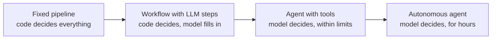
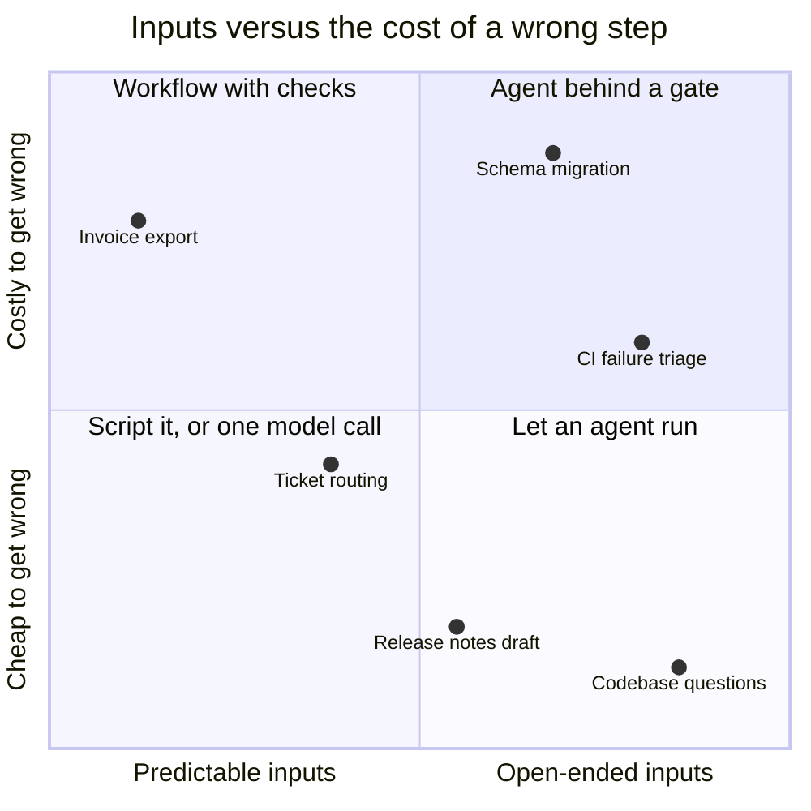
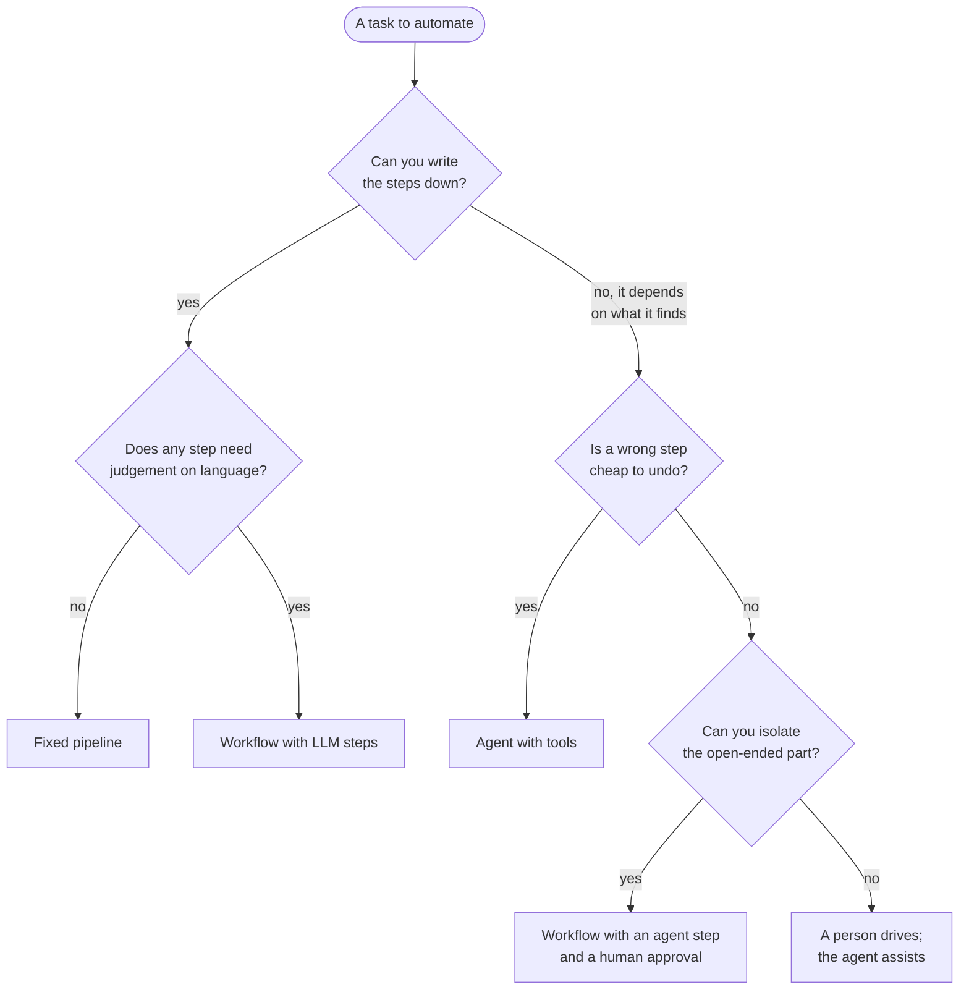
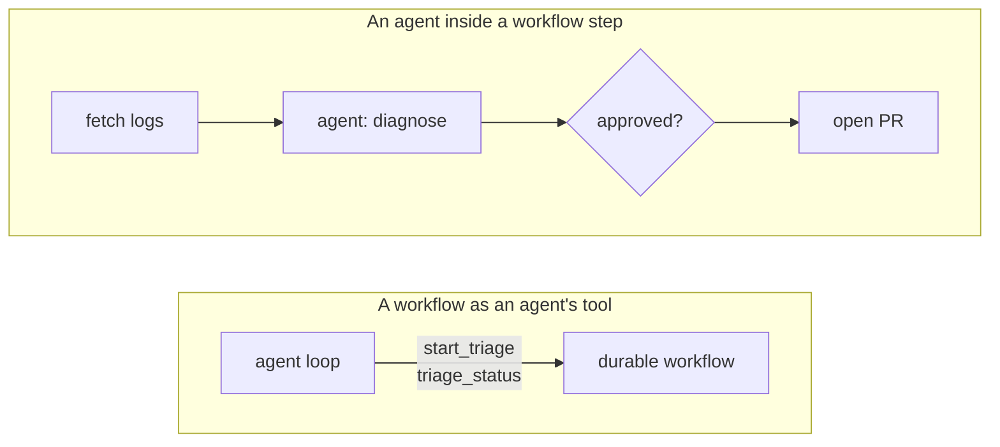
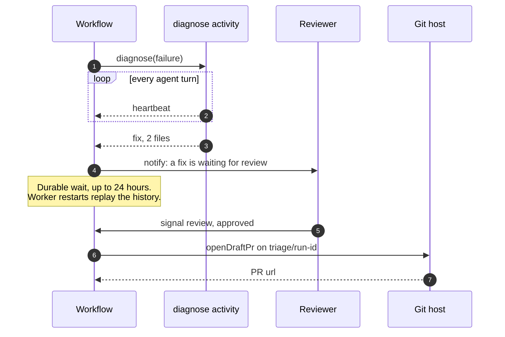

«¿Esto debería ser un agente?» se pregunta ahora de casi todo. Hacer el triaje de una _build_
fallida, redactar notas de versión, enrutar un ticket de soporte, migrar un formato de
configuración en cuarenta repositorios. La pregunta suele plantearse como sí o no, y ese
planteamiento es casi todo el problema.

El artículo de Anthropic [Building effective agents](https://www.anthropic.com/engineering/building-effective-agents)
traza la línea que más útil me resulta. Los **workflows** son sistemas en los que modelos y
herramientas se orquestan mediante caminos de código que escribiste de antemano. Los **agentes**
son sistemas en los que el modelo dirige su propio proceso: decide qué herramienta llamar después,
y cuándo ha terminado. Los dos son «sistemas agénticos». La diferencia está en _quién controla el
flujo_.

Visto así, la pregunta deja de ser «¿agente o no?» y pasa a ser «en este paso, ¿quién debería
decidir qué pasa después: mi código o el modelo?». Un mismo sistema puede responder distinto en
pasos distintos, y los buenos suelen hacerlo.

## El espectro



**Un pipeline fijo** no tiene ningún modelo en el flujo de control. Puede que no tenga un modelo
en ninguna parte. Un job nocturno que exporta facturas, un pipeline de CI, un cron que rota
certificados. Si puedes escribirlo así, deberías, y la llegada de los LLM no ha cambiado eso.

**Un workflow con pasos de LLM** sigue siendo un pipeline: el orden de los pasos está en tu
código, pero algunos pasos llaman a un modelo para algo que solo un modelo sabe hacer, como
clasificar un ticket, resumir un diff o extraer campos de un correo. El artículo de Anthropic pone
nombre a las formas habituales: _prompt chaining_ (una llamada alimenta a la siguiente, con
comprobaciones entre medias), _routing_ (clasificar y mandar a un camino especializado),
_parallelization_ (dividir el trabajo, o preguntar varias veces y votar), y los bucles
_orchestrator-workers_ y _evaluator-optimizer_. Todas mantienen el camino general en el código.

**Un agente con herramientas** ejecuta un bucle: el modelo mira el estado, elige una herramienta,
lee el resultado y repite hasta que decide parar. Tú eliges las herramientas, las instrucciones y
los límites (turnos, tiempo, presupuesto); el modelo elige el camino. Es lo que hacen los agentes
de código cuando les pides que arreglen un test que falla.

**Un agente autónomo** es el mismo bucle con la correa más larga: funciona durante horas, decide
sus propios subobjetivos dentro de un mandato y puede que ningún humano mire nunca un paso
intermedio. Necesita todo lo que necesita el nivel anterior, más una evaluación mucho mejor y una
recuperación mucho mejor.

| Nivel                         | Quién elige el siguiente paso | Cómo es un fallo                                   | Cómo se prueba                                  |
| ----------------------------- | ----------------------------- | -------------------------------------------------- | ----------------------------------------------- |
| **Pipeline fijo**             | Tu código                     | Una excepción en una línea conocida                | Tests unitarios y de integración                |
| **Workflow con pasos de LLM** | Tu código                     | Una salida plausible pero errónea de un paso       | Tests, más _evals_ en cada paso con modelo      |
| **Agente con herramientas**   | El modelo, en cada turno      | Un camino razonable que lleva al sitio equivocado  | _Evals_ sobre trayectorias completas            |
| **Agente autónomo**           | El modelo, en cada objetivo   | Una deriva que nadie ve hasta el final             | _Evals_, monitorización y auditorías a posteriori |

La tabla es el argumento en miniatura. Cada paso hacia la derecha compra flexibilidad y la paga
en lo difícil que es saber si la cosa funciona.

## Cuatro preguntas que lo deciden

No uso una rúbrica con puntuaciones. Me hago cuatro preguntas sobre la tarea, y normalmente una de
ellas lo resuelve.

**¿Cuánto varían las entradas?** Si el siguiente paso depende de lo que encuentres (una traza que
apunta a un sitio inesperado, un repositorio con una estructura que no habías previsto), no puedes
escribir el camino de antemano, y ese es el caso real para un agente. Si las entradas varían en
_contenido_ pero no en _forma_ (cada ticket hay que clasificarlo y luego enrutarlo), basta con un
workflow con un paso de modelo.

**¿Cuánto cuesta un paso equivocado?** Leer un fichero sale gratis aunque te equivoques. Borrar una
rama, mandar un correo o aplicar una migración, no. Cuanto más irreversibles sean las acciones, más
las quiero en código, detrás de una comprobación, y con el modelo limitado a proponer.

**¿Alguien necesita auditarlo?** «¿Por qué hizo eso?» es fácil de responder en un workflow: este es
el camino de código, esta es la entrada de cada paso. En un agente la respuesta es una
trayectoria, que puedes guardar y leer, pero no razonar de antemano. Si una revisión de
cumplimiento, un _post-mortem_ o simplemente un compañero escéptico va a necesitar la respuesta,
eso empuja hacia un workflow.

**¿Qué latencia y qué coste te puedes permitir?** Los agentes gastan tokens decidiendo qué hacer, y
cada turno añade una vuelta al modelo. El artículo de Anthropic lo dice sin rodeos: los sistemas
agénticos cambian latencia y coste por un mejor rendimiento en la tarea, y solo hay que hacer ese
cambio cuando compensa. Un paso de enrutado que se ejecuta diez mil veces al día debería ser una
llamada barata, no un bucle.



La posición de cada punto es criterio mío, no una medida, y tu versión de cada tarea puede caer en
otro sitio. Lo que importa es la forma: arriba a la derecha es donde está el trabajo interesante,
y no es ni un agente puro ni un workflow puro.



> [!TIP]
> Empieza un nivel a la izquierda de donde crees que tienes que estar. El consejo de Anthropic es
> buscar la solución más sencilla y añadir complejidad solo cuando haga falta, y una única llamada
> al modelo con un buen prompt y buena recuperación de contexto cubre más de lo que parece.

## Ejecución duradera: lo que necesitan los dos

Esté lo que esté en el flujo de control, el proceso que lo rodea falla de formas aburridas. La API
del modelo devuelve un 529. El pod del _worker_ se reprograma. Un paso espera a una persona que se
va de vacaciones. Un workflow de nueve pasos que muere en el séptimo no debería repetir los seis
primeros, y un agente que lleva veinte minutos investigando no debería empezar de cero porque su
contenedor se ha reiniciado.

Los motores de ejecución duradera existen exactamente para esto. Usaré [Temporal](https://docs.temporal.io/)
porque su modelo es el más claro, pero las ideas se trasladan.

- **El código del workflow tiene que ser determinista.** Temporal guarda un historial de eventos
  con todo lo que ha hecho el workflow, y se recupera _reproduciendo_ el código contra ese
  historial. La [documentación](https://docs.temporal.io/workflow-definition) pone las llamadas a
  LLM, a APIs y a bases de datos explícitamente en la categoría de lo no determinista, lo que
  significa que no van en el código del workflow.
- **El trabajo no determinista va en actividades.** Una actividad se ejecuta fuera de la
  reproducción, y su resultado queda registrado. Si el _worker_ muere después de que termine una
  llamada al modelo, la reproducción lee la respuesta guardada en vez de volver a llamar al modelo,
  así que no la pagas dos veces ni obtienes una respuesta distinta la segunda.
- **Las actividades se reintentan según una política.** La [política por defecto](https://docs.temporal.io/encyclopedia/retry-policies)
  empieza en un segundo, se duplica cada vez, tiene un tope de cien segundos y no deja de intentarlo
  nunca. Eso está bien para una API inestable y mal para una ejecución de agente cara, así que se
  ajusta por actividad. Los errores marcados como no reintentables la detienen de inmediato.
- **Esperar es gratis.** Un workflow puede esperar una señal, o un temporizador, durante días, sin
  ocupar un proceso. Eso es lo que hace práctica la aprobación humana, en lugar de un bucle de
  sondeo del que te vas a arrepentir.

```steps
Checkpoint: Cada paso completado queda registrado. Una caída se reanuda tras el último, no desde el principio.
Reintento: Los pasos fallidos se reintentan con espera creciente, cada uno con una política acorde a lo que cuesta.
Espera: Temporizadores y señales permiten pausar por una persona o un plazo sin ocupar un proceso.
Reanudación: Un worker nuevo reproduce el historial y sigue exactamente donde se paró el anterior.
```

Los _frameworks_ de agentes han convergido en partes de esto. LangGraph, por ejemplo, guarda el
estado del grafo mediante un _checkpointer_ y puede pausar una ejecución con
[`interrupt()`](https://docs.langchain.com/oss/python/langgraph/interrupts) hasta que la reanudas
con el mismo _thread id_. Cubre bien el caso de una persona en el bucle; lo que no te da son
políticas de reintento por paso ni la reproducción de código arbitrario.

> [!WARNING]
> Las actividades se ejecutan _al menos una vez_. Un reintento tras un _timeout_ puede repetir un
> efecto que ya ocurrió. Toda actividad que escribe (abre un PR, publica un mensaje, cobra una
> tarjeta) necesita una clave de idempotencia, o el reintento que te salva de una red inestable
> también te abrirá dos _pull requests_.

## Híbridos: donde están la mayoría de los buenos sistemas

Los dos híbridos que importan son imágenes especulares.



**Un agente dentro de un paso de workflow.** El workflow es dueño del camino: reunir entradas,
ejecutar el agente, comprobar lo que ha producido, preguntar a una persona, actuar. El agente es
dueño de un paso acotado y abierto, y tiene herramientas de solo lectura. Todo lo irreversible
ocurre en código normal, después de la puerta.

**Un workflow como herramienta de un agente.** El agente decide _si_ y _cuándo_ hacer algo; el
workflow decide _cómo_, de forma duradera. El agente tiene una herramienta que arranca un workflow
y devuelve un _handle_, y otra que informa de su estado. El agente no puede saltarse un paso de un
proceso de _release_, porque saltárselo no le corresponde.

### Un agente dentro de un workflow, en Temporal

Este es el primer híbrido: el triaje de una ejecución nocturna de CI que ha fallado. El workflow
obtiene el fallo, deja que un agente lo diagnostique y, o bien informa de que es inestable, o bien
espera a que una persona apruebe un arreglo antes de abrir un PR en borrador. Está escrito con el
SDK de TypeScript de Temporal.

```ts title="src/workflows.ts" {5-14,31-34}
import { condition, defineSignal, proxyActivities, setHandler } from "@temporalio/workflow";
import type * as activities from "./activities";

// Plain steps: short timeout, retried with backoff.
const { fetchFailure, notify, openDraftPr } = proxyActivities<typeof activities>({
  startToCloseTimeout: "2 minutes",
  retry: { initialInterval: "2s", backoffCoefficient: 2, maximumAttempts: 5 },
});
// The agent step: a bigger budget, a heartbeat, and almost no retries.
const { diagnose } = proxyActivities<typeof activities>({
  startToCloseTimeout: "20 minutes",
  heartbeatTimeout: "2 minutes",
  retry: { maximumAttempts: 2, nonRetryableErrorTypes: ["AgentGaveUp"] },
});

type Verdict = { approved: boolean; reviewer: string };
export const review = defineSignal<[Verdict]>("review");

export async function triageNightlyFailure(runId: string): Promise<string> {
  const state: { verdict?: Verdict } = {};
  setHandler(review, (verdict) => { state.verdict = verdict; });

  const failure = await fetchFailure(runId);
  const diagnosis = await diagnose(failure);
  if (diagnosis.kind === "flake") {
    await notify(`${runId} looks flaky: ${diagnosis.summary}`);
    return "flake";
  }

  await notify(`${runId}: a fix is waiting for review`, diagnosis);
  const answered = await condition(() => state.verdict !== undefined, "24 hours");
  const verdict = state.verdict;
  if (!answered || !verdict?.approved) return "dropped";
  return openDraftPr(runId, diagnosis, verdict.reviewer);
}
```

Que haya dos políticas de reintento en un mismo fichero es precisamente la idea. Una llamada HTTP
fallida al proveedor de CI debería reintentarse hasta que funcione. Una ejecución de agente de
veinte minutos que se ha rendido no debería reintentarse nunca, y una que ha devuelto algo mal
formado merece exactamente una oportunidad más. El `condition` de 24 horas es una espera duradera:
el _worker_ puede reiniciarse una docena de veces y el workflow seguirá esperando la señal, o el
_timeout_.

El paso del agente es una actividad normal. `runAgent` representa tu propio bucle de agente (la
llamada al modelo, el despacho de herramientas, el límite de turnos), que es el tema de
[harness engineering](/blog/harness-engineering); lo que importa aquí es el contrato que lo rodea.

```ts title="src/activities.ts" {14,24,28-31}
import { heartbeat } from "@temporalio/activity";
import { ApplicationFailure } from "@temporalio/common";
import * as z from "zod";
import { runAgent } from "./agent"; // illustrative: your loop, model and tools

export interface Failure { runId: string; job: string; logTail: string }

const Diagnosis = z.discriminatedUnion("kind", [
  z.object({ kind: z.literal("flake"), summary: z.string() }),
  z.object({
    kind: z.literal("fix"),
    summary: z.string(),
    patch: z.string(),
    files: z.array(z.string()).min(1).max(5), // bigger than this is not a triage fix
  }),
]);
export type Diagnosis = z.infer<typeof Diagnosis>;

export async function diagnose(failure: Failure): Promise<Diagnosis> {
  const run = await runAgent({
    instructions:
      "Explain why this CI job failed. Propose the smallest fix, or call it a flake.",
    input: failure.logTail,
    tools: ["read_file", "grep", "git_log"], // read-only: writing is the workflow's job
    maxTurns: 25,
    onTurn: () => heartbeat(),
  });
  if (run.stopReason === "max_turns") {
    throw ApplicationFailure.nonRetryable("Agent ran out of turns", "AgentGaveUp");
  }
  return Diagnosis.parse(run.output); // malformed output throws and gets its one retry
}
// fetchFailure, notify and openDraftPr are plain API calls. openDraftPr pushes to
// the branch `triage/<runId>`, so a retry finds the PR it already opened.
```

El esquema es donde el workflow cumple sus promesas con el resto del sistema. El agente puede
explorar como quiera, pero lo que sale es o un fallo inestable con un resumen o un arreglo de cinco
ficheros como mucho, y cualquier otra cosa falla de forma ruidosa. El _heartbeat_ en cada turno
permite a Temporal distinguir un agente lento de uno muerto.



### Un workflow como herramienta de un agente

La imagen especular necesita menos código. Expón dos herramientas al agente, una para arrancar el
workflow y otra para preguntar cómo va, y usa el id de la ejecución de CI como id del workflow para
que preguntar dos veces no arranque dos triajes. Esto es pegamento, no un servidor completo: en la
práctica serían herramientas MCP, y el id del workflow es justo el tipo de _handle_ explícito que
la especificación actual de MCP pide devolver a las herramientas con estado (más en
[MCP y A2A](/blog/mcp-vs-a2a)).

```ts title="src/tools/triage.ts"
import {
  Client,
  Connection,
  WorkflowExecutionAlreadyStartedError,
} from "@temporalio/client";
import { triageNightlyFailure } from "../workflows";

const client = new Client({ connection: await Connection.connect() });

export async function startTriage({ runId }: { runId: string }) {
  const workflowId = `triage-${runId}`; // one triage per run, however often the agent asks
  try {
    await client.workflow.start(triageNightlyFailure, {
      taskQueue: "triage",
      workflowId,
      args: [runId],
    });
    return { workflowId, status: "started" };
  } catch (err) {
    if (err instanceof WorkflowExecutionAlreadyStartedError) {
      return { workflowId, status: "already running" };
    }
    throw err;
  }
}

export async function triageStatus({ workflowId }: { workflowId: string }) {
  const { status } = await client.workflow.getHandle(workflowId).describe();
  return { workflowId, status: status.name }; // RUNNING, COMPLETED, FAILED…
}
```

El agente no ve nunca el paso de aprobación, las políticas de reintento ni la lógica del PR. Solo
puede arrancar el proceso y observarlo, que es exactamente el poder que debe tener. Elegir entre
esta forma y la anterior es sobre todo cuestión de con quién habla el usuario: si habla con un
agente que hace muchas cosas, el workflow pasa a ser una de sus herramientas; si el proceso es el
producto, el agente pasa a ser uno de sus pasos. Cómo componer varios de estos está en
[patrones de orquestación de agentes](/blog/agent-orchestration-patterns).

## Cuándo no, y qué no arregla esto

**No montes un motor de workflows para un script.** Temporal es un clúster que mantener, o un
servicio que pagar, más un modelo de programación que tu equipo tiene que aprender: reglas de
determinismo, versionado cuando cambias un workflow con ejecuciones en curso. Para una tarea que
dura treinta segundos y que se puede volver a lanzar sin más, un script con un bucle de reintentos
es la respuesta correcta.

**No montes un agente para una consulta.** Si la tarea es «clasifica esto y mándalo allí», un
bucle que decide qué herramienta llamar está pagando por una decisión que solo tiene una
respuesta.

**No dejes que la durabilidad esconda un mal paso.** Un workflow duradero alrededor de un agente
que se equivoca sigue equivocándose; solo que lo hace de forma fiable, y tras un reintento. La
ejecución duradera te protege de fallos de infraestructura, no de fallos de criterio. Para esos
necesitas evaluar el paso del agente con casos reales, y una puerta delante de todo lo que no se
pueda deshacer.

> [!IMPORTANT]
> El paso de aprobación solo funciona si quien revisa puede juzgar de verdad lo que aprueba. Un
> diff de cinco ficheros con un resumen de una línea se puede revisar. «El agente quiere
> continuar» no es una puerta, es un botón.

Y la línea se mueve. Un paso que hoy necesita un agente puede ser mañana un workflow, cuando hayas
visto suficientes ejecuciones como para escribir el camino, y al revés cuando las entradas se
vuelven más desordenadas de lo previsto. Prefiero diseñar para que un paso pueda cambiar de lado
sin reescribir todo lo que lo rodea, que es el argumento de verdad a favor de los híbridos.

## Para seguir aprendiendo

- [Building effective agents](https://www.anthropic.com/engineering/building-effective-agents):
  el artículo de Anthropic que define workflows frente a agentes, con los cinco patrones de
  workflow y un consejo claro sobre empezar por lo sencillo. La referencia de la primera mitad de
  este artículo.
- [Temporal: Workflow definition](https://docs.temporal.io/workflow-definition): por qué el código
  del workflow tiene que ser determinista, cómo funciona la reproducción y qué va en las
  actividades. Corto, y merece la pena entenderlo antes de escribir tu primer workflow.
- [Temporal: Retry policies](https://docs.temporal.io/encyclopedia/retry-policies): la política por
  defecto, los errores no reintentables y en qué se diferencian los reintentos de actividades y de
  workflows.
- [Temporal: Workflow message passing](https://docs.temporal.io/develop/typescript/workflows/message-passing):
  señales, _queries_ y _updates_ en el SDK de TypeScript, las piezas de los pasos con una persona en
  el bucle.
- [LangGraph: Interrupts](https://docs.langchain.com/oss/python/langgraph/interrupts): cómo un grafo
  se pausa para pedir una entrada humana y se reanuda desde un _checkpoint_; útil para compararlo
  con el modelo de Temporal.
- [Temporal y el AI SDK de Vercel](https://temporal.io/blog/building-durable-agents-with-temporal-and-ai-sdk-by-vercel):
  un ejemplo completo de cómo ejecutar las llamadas al modelo y las herramientas de un agente como
  actividades, en el blog de Temporal.
